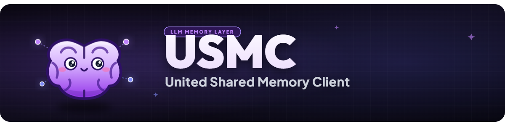
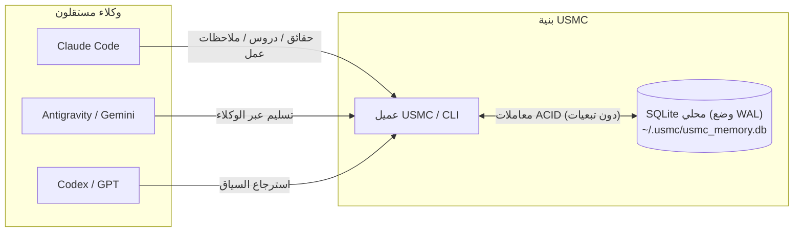

# USMC — United Shared Memory Client

[](https://github.com/ellmos-ai/usmc/actions/workflows/ci.yml)
[](#install-and-try)
[](.github/dependabot.yml)
[](LICENSE)
[](pyproject.toml)
[](#data-and-runtime-scope)
[-informational.svg)](#data-and-runtime-scope)

**اللغات:** [English](README.md) · [Deutsch](README_de.md) · [Español](README_es.md) · [Français](README_fr.md) · [Português](README_pt.md) · [Русский](README_ru.md) · [简体中文](README_zh.md) · [日本語](README_ja.md) · [العربية](README_ar.md) · [हिन्दी](README_hi.md) · [বাংলা](README_bn.md)

<!-- lang-only: en,fr,pt,ru,zh,ja,ar,hi,bn -->
> تحلّ نقطة الدخول الموجزة هذه محل ملف `README.md` الطويل السابق من [الالتزام المصدري `bf281f1`](https://github.com/ellmos-ai/usmc/blob/bf281f1d68e9e6af44db9d12588a000fac531a61/README.md). تتوفر النسخة الأرشيفية المصحَّحة الآن في [docs/archive/README.full.en.md](docs/archive/README.full.en.md) (بالإنجليزية)، بينما يحفظ الالتزام المرتبط المراجعة المصدرية الأصلية.
<!-- /lang-only -->

USMC هي حزمة Python وأداة CLI تخزّن الحقائق والدروس المستفادة وملاحظات العمل وتسليمات الجلسات في SQLite. قائمة التبعيات المباشرة المُعلَنة وقت التشغيل فارغة؛ ويلزم توفّر Python 3.10 أو أحدث.

<a id="data-and-runtime-scope"></a>
## البيانات ونطاق التشغيل

المسار الافتراضي لقاعدة البيانات هو `~/.usmc/usmc_memory.db`. عيّن `USMC_DB` أو مرّر `--db` لاختيار مسار آخر؛ وتُستخدم المسارات المخصّصة كما تُقدَّم تمامًا. لا تقوم USMC بتقليم السجلات المخزّنة تلقائيًا. اختر مسارًا محليًا مناسبًا وأدِر صلاحياته ونسخه الاحتياطية وسياسة الاحتفاظ به بما يلائم حالة استخدامك.



لا يحتوي الكود المصدري المُراجَع للحزمة على أي عميل HTTP مباشر. يستخدم التثبيت من GitHub أو بناء الحزمة أدوات قادرة على الاتصال بالشبكة، وقد يستخدم الوكيل المستدعي أو أي عملية أخرى الشبكة بشكل مستقل. لا توفّر USMC جدار حماية أو بيئة عزل (sandbox)؛ إذ ترث العمليات صلاحيات الجهة التي أطلقتها.

<a id="install-and-try"></a>
## التثبيت والتجربة

ثبّت من مصدر Git (يتطلب ذلك أدوات تحزيم Git/Python ووصولًا إلى الشبكة):

```console
python -m pip install "git+https://github.com/ellmos-ai/usmc.git"
usmc --help
usmc status
```

لنسخة مستودع محلية، استخدم `python -m pip install -e ".[test]"`، حيث إن الإضافة `[test]` مخصّصة للتطوير والاختبار.

```python
from usmc import USMCClient

client = USMCClient(agent_id="codex")
client.add_fact("project", "status", "in progress", confidence=0.8)
print(client.generate_context())
```

## التوثيق

- [الدليل الكامل وأمثلة API](docs/archive/README.full.en.md) (بالإنجليزية)
- [قواعد السلوك](CODE_OF_CONDUCT.md)
- [ملاحظات الأمان ومعالجة البيانات](SECURITY.md)
- [المساهمة وأوامر الاختبار](CONTRIBUTING.md)
- [جرد تراخيص الأطراف الثالثة](THIRD_PARTY_LICENSES.md) و[ملاحظات التراخيص بصيغة نص عادي](THIRD_PARTY_LICENSES.txt)
- [الدليل المقروء آليًا](llms.txt)
- [سجل التغييرات](CHANGELOG.md)

## المشاريع ذات الصلة

يمكن لـ [BACH](https://github.com/ellmos-ai/bach) استخدام مخطط الذاكرة المشتركة الاختياري المعرَّف بواسطة ملف `memory_union.contract.json` الخاص بـ USMC؛ راجع تفاصيل الترحيل والتفعيل الاختياري في الدليل الكامل. يصف هذا علاقة مخطط فقط، وليس تثبيتًا تلقائيًا أو حدًا أمنيًا.
يدمج [ellmos-stack](https://github.com/ellmos-ai/ellmos-stack) أداة USMC بصفتها مكون الذاكرة المنسّقة في حزمة أبحاث مستضافة ذاتيًا؛ ويجلب مثبّت الحزمة أداة USMC من التزام Git مثبّت. يصف هذا تكوين الحزمة تلك، وليس ضمان تثبيت أو تشغيل تقدّمه USMC.
يوفّر [GARDENER](https://github.com/ellmos-ai/gardener) قوالب مصادر اختيارية للقراءة فقط للقطات النسخ المتماثل الخاصة بـ USMC؛ وهي معطّلة افتراضيًا وتتطلب لقطة مزامنة منفصلة وتفعيلًا صريحًا من المستدعي.

## الترخيص

يُوفَّر هذا المشروع بموجب [رخصة MIT](LICENSE)؛ وترد تفاصيل الإسناد في ملف [NOTICE](NOTICE).

### روابط الأقسام السابقة

<a id="sec-01"></a>
<a id="key-features"></a>
<a id="hauptmerkmale"></a>
<a id="características-principales"></a>
1. [فتح القسم المؤرشف](docs/archive/README.full.en.md#sec-01)

<a id="sec-02"></a>
<a id="core-capabilities--primitives"></a>
<a id="kernkonzepte--primitive"></a>
<a id="conceptos-clave-y-primitivas"></a>
2. [فتح القسم المؤرشف](docs/archive/README.full.en.md#sec-02)

<a id="sec-03"></a>
<a id="target-personas--discoverability"></a>
<a id="zielgruppen--auffindbarkeit"></a>
<a id="arquetipos-de-usuario--visibilidad"></a>
3. [فتح القسم المؤرشف](docs/archive/README.full.en.md#sec-03)

<a id="sec-04"></a>
<a id="comparative-matrix-vs-alternatives"></a>
<a id="vergleichsmatrix-gegenueber-alternativen"></a>
<a id="matriz-comparativa-frente-a-alternativas"></a>
4. [فتح القسم المؤرشف](docs/archive/README.full.en.md#sec-04)

<a id="sec-05"></a>
<a id="architecture--data-flow"></a>
<a id="architektur--datenfluss"></a>
<a id="arquitectura-y-flujo-de-datos"></a>
5. [فتح القسم المؤرشف](docs/archive/README.full.en.md#sec-05)

<a id="sec-06"></a>
<a id="ascii-topology"></a>
<a id="ascii-topologie"></a>
<a id="topologia-ascii"></a>
6. [فتح القسم المؤرشف](docs/archive/README.full.en.md#sec-06)

<a id="sec-07"></a>
<a id="multi-agent-interaction-sequence"></a>
<a id="multi-agenten-interaktionssequenz"></a>
<a id="secuencia-de-interacción-multi-agente"></a>
7. [فتح القسم المؤرشف](docs/archive/README.full.en.md#sec-07)

<a id="sec-08"></a>
<a id="governance--runtime-invariants"></a>
<a id="governance--laufzeit-invarianten"></a>
<a id="invariantes-de-gobernanza-y-ejecución"></a>
8. [فتح القسم المؤرشف](docs/archive/README.full.en.md#sec-08)

<a id="sec-09"></a>
<a id="quick-start"></a>
<a id="schnellstart"></a>
<a id="inicio-rápido"></a>
9. [فتح القسم المؤرشف](docs/archive/README.full.en.md#sec-09)

<a id="sec-10"></a>
<a id="core-concepts--primitives"></a>
<a id="kernkonzepte--primitive-details"></a>
<a id="conceptos-clave-detalles"></a>
10. [فتح القسم المؤرشف](docs/archive/README.full.en.md#sec-10)

<a id="sec-11"></a>
<a id="finding-things--advanced-filtering"></a>
<a id="gezieltes-suchen--filterung"></a>
<a id="búsqueda-precisa-y-filtros"></a>
11. [فتح القسم المؤرشف](docs/archive/README.full.en.md#sec-11)

<a id="sec-12"></a>
<a id="multi-agent-session-coordination"></a>
<a id="multi-agenten-sitzungskoordination"></a>
<a id="coordinación-de-sesiones-multi-agente"></a>
12. [فتح القسم المؤرشف](docs/archive/README.full.en.md#sec-12)

<a id="sec-13"></a>
<a id="runtime-language-contract"></a>
<a id="laufzeit-sprachvertrag"></a>
<a id="contrato-de-idioma-en-ejecución"></a>
13. [فتح القسم المؤرشف](docs/archive/README.full.en.md#sec-13)

<a id="sec-14"></a>
<a id="database-schema--state-isolation"></a>
<a id="datenbankschema--status-isolation"></a>
<a id="esquema-de-base-de-datos-y-aislamiento"></a>
14. [فتح القسم المؤرشف](docs/archive/README.full.en.md#sec-14)

<a id="sec-15"></a>
<a id="sibling-ecosystem--positioning"></a>
<a id="geschwister-oekosystem--positionierung"></a>
<a id="ecosistema-hermano-y-posicionamiento"></a>
15. [فتح القسم المؤرشف](docs/archive/README.full.en.md#sec-15)

<a id="sec-16"></a>
<a id="testing--quality-gates"></a>
<a id="testen--qualitaetstore"></a>
<a id="pruebas-y-verificacion"></a>
16. [فتح القسم المؤرشف](docs/archive/README.full.en.md#sec-16)

<a id="sec-17"></a>
<a id="third-party-licenses--transparency"></a>
<a id="drittanbieter-lizenzen--transparenz"></a>
<a id="licencias-de-terceros-y-transparencia"></a>
17. [فتح القسم المؤرشف](docs/archive/README.full.en.md#sec-17)

<a id="sec-18"></a>
<a id="security-policy--liability"></a>
<a id="sicherheitsrichtlinie--haftung"></a>
<a id="politica-de-seguridad-y-responsabilidad"></a>
<a id="license--liability"></a>
<a id="lizenz--haftung"></a>
<a id="licencia-y-responsabilidad"></a>
<a id="security-policy--vulnerability-reporting"></a>
<a id="sicherheitsrichtlinie--meldewege"></a>
<a id="política-de-seguridad-y-reporte-de-vulnerabilidades"></a>
18. [فتح القسم المؤرشف](docs/archive/README.full.en.md#sec-18)
