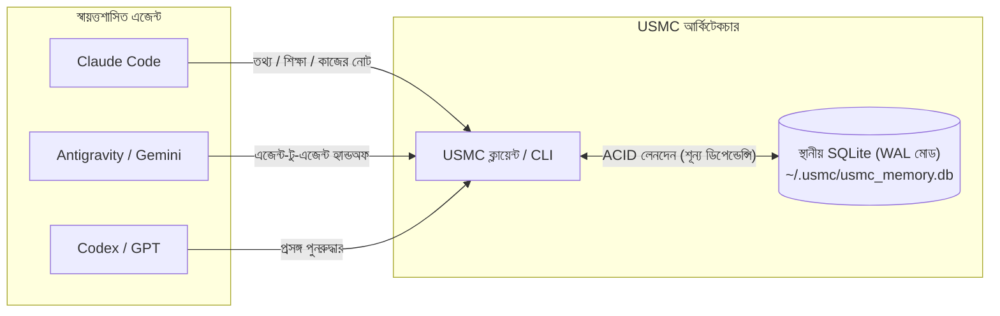

# USMC — United Shared Memory Client

[](https://github.com/ellmos-ai/usmc/actions/workflows/ci.yml)
[](#install-and-try)
[](.github/dependabot.yml)
[](LICENSE)
[](pyproject.toml)
[](#data-and-runtime-scope)
[-informational.svg)](#data-and-runtime-scope)

**ভাষাসমূহ:** [English](README.md) · [Deutsch](README_de.md) · [Español](README_es.md) · [Français](README_fr.md) · [Português](README_pt.md) · [Русский](README_ru.md) · [简体中文](README_zh.md) · [日本語](README_ja.md) · [العربية](README_ar.md) · [हिन्दी](README_hi.md) · [বাংলা](README_bn.md)

<!-- lang-only: en,fr,pt,ru,zh,ja,ar,hi,bn -->
> এই সংক্ষিপ্ত প্রবেশদ্বারটি [উৎস কমিট `bf281f1`](https://github.com/ellmos-ai/usmc/blob/bf281f1d68e9e6af44db9d12588a000fac531a61/README.md)-এর পূর্বের দীর্ঘ `README.md`-এর স্থলাভিষিক্ত। এর সংশোধিত সংরক্ষণাগার সংস্করণ এখন [docs/archive/README.full.en.md](docs/archive/README.full.en.md) (ইংরেজিতে)-এ রয়েছে; লিঙ্ক করা কমিটটি মূল উৎস সংস্করণটি সংরক্ষণ করে।
<!-- /lang-only -->

USMC একটি Python প্যাকেজ এবং CLI যা SQLite-এ তথ্য, অভিজ্ঞতালব্ধ শিক্ষা, কাজের নোট এবং সেশন হ্যান্ডঅফ সংরক্ষণ করে। ঘোষিত সরাসরি রানটাইম ডিপেন্ডেন্সি তালিকাটি ফাঁকা; এর জন্য Python 3.10 বা তার নতুন সংস্করণ প্রয়োজন।

<a id="data-and-runtime-scope"></a>
## ডেটা এবং রানটাইম পরিধি

ডিফল্টভাবে, ডেটাবেস পাথ হলো `~/.usmc/usmc_memory.db`। অন্য কোনো পাথ বেছে নিতে `USMC_DB` সেট করুন অথবা `--db` পাস করুন; কাস্টম পাথগুলো ঠিক যেভাবে দেওয়া হয় সেভাবেই ব্যবহৃত হয়। USMC সংরক্ষিত রেকর্ডগুলো স্বয়ংক্রিয়ভাবে মুছে ফেলে না (prune করে না)। একটি উপযুক্ত স্থানীয় পাথ বেছে নিন এবং আপনার ব্যবহারের ক্ষেত্র অনুযায়ী এর অনুমতি, ব্যাকআপ এবং সংরক্ষণকাল (retention) পরিচালনা করুন।



পর্যালোচিত প্যাকেজ উৎসে কোনো সরাসরি HTTP ক্লায়েন্ট নেই। GitHub থেকে ইনস্টল করা বা প্যাকেজ বিল্ড করার ক্ষেত্রে নেটওয়ার্ক-সক্ষম টুল ব্যবহৃত হয়, এবং কলকারী এজেন্ট বা অন্য কোনো প্রক্রিয়া স্বাধীনভাবে নেটওয়ার্ক ব্যবহার করতে পারে। USMC কোনো ফায়ারওয়াল বা স্যান্ডবক্স প্রদান করে না; প্রক্রিয়াগুলো তাদের লঞ্চারের অধিকার (privileges) উত্তরাধিকারসূত্রে পায়।

<a id="install-and-try"></a>
## ইনস্টল করুন এবং পরীক্ষা করে দেখুন

Git উৎস থেকে ইনস্টল করুন (এর জন্য Git/Python প্যাকেজিং টুল এবং নেটওয়ার্ক অ্যাক্সেস প্রয়োজন):

```console
python -m pip install "git+https://github.com/ellmos-ai/usmc.git"
usmc --help
usmc status
usmc setup --dry-run
```

স্থানীয় চেকআউটের জন্য `python -m pip install -e ".[test]"` ব্যবহার করুন। `[test]` এক্সট্রাটি ডেভেলপমেন্ট এবং টেস্টিংয়ের জন্য।

```python
from usmc import USMCClient

client = USMCClient(agent_id="codex")
client.add_fact("project", "status", "in progress", confidence=0.8)
print(client.generate_context())
```

## ডকুমেন্টেশন

- [সম্পূর্ণ নির্দেশিকা এবং API উদাহরণ](docs/archive/README.full.en.md) (ইংরেজিতে)
- [আচরণবিধি](CODE_OF_CONDUCT.md)
- [নিরাপত্তা ও ডেটা-পরিচালনা সংক্রান্ত নোট](SECURITY.md)
- [অবদান এবং টেস্ট কমান্ড](CONTRIBUTING.md)
- [তৃতীয় পক্ষের লাইসেন্স তালিকা](THIRD_PARTY_LICENSES.md) এবং [সাধারণ-পাঠ্য লাইসেন্স নোট](THIRD_PARTY_LICENSES.txt)
- [মেশিন-পাঠযোগ্য নির্দেশিকা](llms.txt)
- [পরিবর্তন তালিকা (Changelog)](CHANGELOG.md)

## সংশ্লিষ্ট প্রকল্পসমূহ

[BACH](https://github.com/ellmos-ai/bach) USMC-এর `memory_union.contract.json` দ্বারা সংজ্ঞায়িত ঐচ্ছিক শেয়ার্ড-মেমরি স্কিমা ব্যবহার করতে পারে; মাইগ্রেশন এবং অপ্ট-ইন সংক্রান্ত বিস্তারিত সম্পূর্ণ নির্দেশিকায় দেখুন। এটি কেবল একটি স্কিমা সম্পর্কের বর্ণনা, স্বয়ংক্রিয় ইনস্টলেশন বা কোনো নিরাপত্তা সীমা নয়।
[ellmos-stack](https://github.com/ellmos-ai/ellmos-stack) একটি স্ব-হোস্টেড গবেষণা স্ট্যাকে তার কিউরেটেড-মেমরি উপাদান হিসেবে USMC-কে অন্তর্ভুক্ত করে; এর ইনস্টলার একটি পিন করা Git কমিট থেকে USMC সংগ্রহ করে। এটি সেই স্ট্যাকের গঠনের বর্ণনা, USMC কর্তৃক প্রদত্ত কোনো ইনস্টলেশন বা চালুর নিশ্চয়তা নয়।
[GARDENER](https://github.com/ellmos-ai/gardener) USMC রেপ্লিকা স্ন্যাপশটের জন্য ঐচ্ছিক শুধুমাত্র-পঠনযোগ্য (read-only) সোর্স টেমপ্লেট সরবরাহ করে; এগুলো ডিফল্টভাবে নিষ্ক্রিয় থাকে এবং এর জন্য একটি পৃথক সিঙ্ক স্ন্যাপশট ও কলকারীর অপ্ট-ইন প্রয়োজন হয়।

## লাইসেন্স

প্রকল্পটি [MIT লাইসেন্স](LICENSE)-এর অধীনে প্রদান করা হয়েছে; স্বীকৃতি (attribution) সংক্রান্ত বিস্তারিত [NOTICE](NOTICE)-এ রয়েছে।

### পূর্ববর্তী অনুচ্ছেদের লিঙ্ক

<a id="sec-01"></a>
<a id="key-features"></a>
<a id="hauptmerkmale"></a>
<a id="características-principales"></a>
1. [সংরক্ষিত অনুচ্ছেদ খুলুন](docs/archive/README.full.en.md#sec-01)

<a id="sec-02"></a>
<a id="core-capabilities--primitives"></a>
<a id="kernkonzepte--primitive"></a>
<a id="conceptos-clave-y-primitivas"></a>
2. [সংরক্ষিত অনুচ্ছেদ খুলুন](docs/archive/README.full.en.md#sec-02)

<a id="sec-03"></a>
<a id="target-personas--discoverability"></a>
<a id="zielgruppen--auffindbarkeit"></a>
<a id="arquetipos-de-usuario--visibilidad"></a>
3. [সংরক্ষিত অনুচ্ছেদ খুলুন](docs/archive/README.full.en.md#sec-03)

<a id="sec-04"></a>
<a id="comparative-matrix-vs-alternatives"></a>
<a id="vergleichsmatrix-gegenueber-alternativen"></a>
<a id="matriz-comparativa-frente-a-alternativas"></a>
4. [সংরক্ষিত অনুচ্ছেদ খুলুন](docs/archive/README.full.en.md#sec-04)

<a id="sec-05"></a>
<a id="architecture--data-flow"></a>
<a id="architektur--datenfluss"></a>
<a id="arquitectura-y-flujo-de-datos"></a>
5. [সংরক্ষিত অনুচ্ছেদ খুলুন](docs/archive/README.full.en.md#sec-05)

<a id="sec-06"></a>
<a id="ascii-topology"></a>
<a id="ascii-topologie"></a>
<a id="topologia-ascii"></a>
6. [সংরক্ষিত অনুচ্ছেদ খুলুন](docs/archive/README.full.en.md#sec-06)

<a id="sec-07"></a>
<a id="multi-agent-interaction-sequence"></a>
<a id="multi-agenten-interaktionssequenz"></a>
<a id="secuencia-de-interacción-multi-agente"></a>
7. [সংরক্ষিত অনুচ্ছেদ খুলুন](docs/archive/README.full.en.md#sec-07)

<a id="sec-08"></a>
<a id="governance--runtime-invariants"></a>
<a id="governance--laufzeit-invarianten"></a>
<a id="invariantes-de-gobernanza-y-ejecución"></a>
8. [সংরক্ষিত অনুচ্ছেদ খুলুন](docs/archive/README.full.en.md#sec-08)

<a id="sec-09"></a>
<a id="quick-start"></a>
<a id="schnellstart"></a>
<a id="inicio-rápido"></a>
9. [সংরক্ষিত অনুচ্ছেদ খুলুন](docs/archive/README.full.en.md#sec-09)

<a id="sec-10"></a>
<a id="core-concepts--primitives"></a>
<a id="kernkonzepte--primitive-details"></a>
<a id="conceptos-clave-detalles"></a>
10. [সংরক্ষিত অনুচ্ছেদ খুলুন](docs/archive/README.full.en.md#sec-10)

<a id="sec-11"></a>
<a id="finding-things--advanced-filtering"></a>
<a id="gezieltes-suchen--filterung"></a>
<a id="búsqueda-precisa-y-filtros"></a>
11. [সংরক্ষিত অনুচ্ছেদ খুলুন](docs/archive/README.full.en.md#sec-11)

<a id="sec-12"></a>
<a id="multi-agent-session-coordination"></a>
<a id="multi-agenten-sitzungskoordination"></a>
<a id="coordinación-de-sesiones-multi-agente"></a>
12. [সংরক্ষিত অনুচ্ছেদ খুলুন](docs/archive/README.full.en.md#sec-12)

<a id="sec-13"></a>
<a id="runtime-language-contract"></a>
<a id="laufzeit-sprachvertrag"></a>
<a id="contrato-de-idioma-en-ejecución"></a>
13. [সংরক্ষিত অনুচ্ছেদ খুলুন](docs/archive/README.full.en.md#sec-13)

<a id="sec-14"></a>
<a id="database-schema--state-isolation"></a>
<a id="datenbankschema--status-isolation"></a>
<a id="esquema-de-base-de-datos-y-aislamiento"></a>
14. [সংরক্ষিত অনুচ্ছেদ খুলুন](docs/archive/README.full.en.md#sec-14)

<a id="sec-15"></a>
<a id="sibling-ecosystem--positioning"></a>
<a id="geschwister-oekosystem--positionierung"></a>
<a id="ecosistema-hermano-y-posicionamiento"></a>
15. [সংরক্ষিত অনুচ্ছেদ খুলুন](docs/archive/README.full.en.md#sec-15)

<a id="sec-16"></a>
<a id="testing--quality-gates"></a>
<a id="testen--qualitaetstore"></a>
<a id="pruebas-y-verificacion"></a>
16. [সংরক্ষিত অনুচ্ছেদ খুলুন](docs/archive/README.full.en.md#sec-16)

<a id="sec-17"></a>
<a id="third-party-licenses--transparency"></a>
<a id="drittanbieter-lizenzen--transparenz"></a>
<a id="licencias-de-terceros-y-transparencia"></a>
17. [সংরক্ষিত অনুচ্ছেদ খুলুন](docs/archive/README.full.en.md#sec-17)

<a id="sec-18"></a>
<a id="security-policy--liability"></a>
<a id="sicherheitsrichtlinie--haftung"></a>
<a id="politica-de-seguridad-y-responsabilidad"></a>
<a id="license--liability"></a>
<a id="lizenz--haftung"></a>
<a id="licencia-y-responsabilidad"></a>
<a id="security-policy--vulnerability-reporting"></a>
<a id="sicherheitsrichtlinie--meldewege"></a>
<a id="política-de-seguridad-y-reporte-de-vulnerabilidades"></a>
18. [সংরক্ষিত অনুচ্ছেদ খুলুন](docs/archive/README.full.en.md#sec-18)
