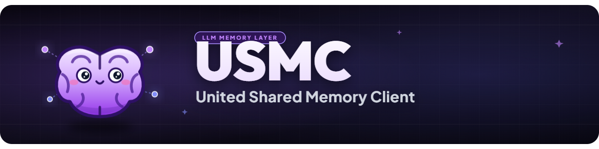

# USMC — United Shared Memory Client

[](https://github.com/ellmos-ai/usmc/actions/workflows/ci.yml)
[](LICENSE)
[](pyproject.toml)

**Sprachen:** [English](README.md) · [Deutsch](README_de.md) · [Español](README_es.md)

> Dieser kompakte Einstieg ersetzt die frühere lange `README_de.md` aus [Quellcommit `bf281f1`](https://github.com/ellmos-ai/usmc/blob/bf281f1d68e9e6af44db9d12588a000fac531a61/README_de.md). Die korrigierte Archivfassung unter [docs/archive/README.full.de.md](docs/archive/README.full.de.md) bewahrt den ausführlichen Leitfaden; der verlinkte Commit enthält die ursprüngliche Quellfassung.

USMC ist ein Python-Paket mit CLI. Es speichert Fakten, Lessons Learned, Arbeitsnotizen und Sitzungsübergaben in SQLite. Die direkte Laufzeit-Abhängigkeitsliste ist leer; erforderlich ist Python 3.10 oder neuer.

## Daten und Laufzeitumfang

Standardmäßig liegt die Datenbank unter `~/.usmc/usmc_memory.db`. Mit `USMC_DB` oder `--db` lässt sich ein anderer Pfad wählen; benutzerdefinierte Pfade werden wie angegeben verwendet. USMC löscht gespeicherte Datensätze nicht automatisch. Wähle einen geeigneten lokalen Pfad und verwalte Berechtigungen, Sicherungen und Aufbewahrung passend zum Einsatz.

Der geprüfte Paketquellcode enthält keinen direkten HTTP-Client. Installation aus GitHub und Paketbau verwenden netzwerkfähige Werkzeuge; aufrufende Agenten oder andere Prozesse können unabhängig davon das Netzwerk nutzen. USMC stellt weder Firewall noch Sandbox bereit. Prozesse erben die Rechte ihres aufrufenden Prozesses.

## Installieren und ausprobieren

Installation aus dem Git-Quellrepository (Git/Python-Paketwerkzeuge und Netzwerkzugriff sind dafür erforderlich):

```console
python -m pip install "git+https://github.com/ellmos-ai/usmc.git"
usmc --help
usmc status
```

Für einen lokalen Checkout: `python -m pip install -e ".[test]"`. Das Extra `[test]` ist für Entwicklung und Tests gedacht.

```python
from usmc import USMCClient

client = USMCClient(agent_id="codex")
client.add_fact("project", "status", "in Arbeit", confidence=0.8)
print(client.generate_context())
```

## Dokumentation

- [Ausführlicher Leitfaden und API-Beispiele](docs/archive/README.full.de.md)
- [Sicherheit und Datenverarbeitung](SECURITY.md)
- [Mitwirken und Testbefehle](CONTRIBUTING.md)
- [Drittanbieter-Lizenzinventar](THIRD_PARTY_LICENSES.md) und [Textfassung](THIRD_PARTY_LICENSES.txt)
- [Maschinenlesbarer Leitfaden](llms.txt)
- [Änderungsprotokoll](CHANGELOG.md)

## Verwandte Projekte

[BACH](https://github.com/ellmos-ai/bach) kann das optionale gemeinsame Speicher-Schema aus USMCs `memory_union.contract.json` verwenden. Details zur Migration und Aktivierung stehen im ausführlichen Leitfaden. Das beschreibt eine Schema-Beziehung, keine automatische Installation und keine Sicherheitsgrenze.
[ellmos-stack](https://github.com/ellmos-ai/ellmos-stack) bindet USMC als kuratierte Gedächtniskomponente in einen selbst gehosteten Forschungs-Stack ein; das Stack-Installationsskript bezieht USMC von einem festgelegten Git-Commit. Das beschreibt die Zusammenstellung des Stacks, nicht eine Installation oder einen Start durch USMC.
[GARDENER](https://github.com/ellmos-ai/gardener) stellt optionale, schreibgeschützte Quellvorlagen für USMC-Replikat-Snapshots bereit. Sie sind standardmäßig deaktiviert und benötigen einen separaten Sync-Snapshot sowie die Aktivierung durch den Aufrufer.

## Lizenz

Das Projekt steht unter der [MIT-Lizenz](LICENSE); der Namenshinweis steht in [NOTICE](NOTICE).

### Verweise auf frühere Abschnitte

<a id="sec-01"></a>
<a id="hauptmerkmale"></a>
<a id="key-features"></a>
<a id="características-principales"></a>
1. [Abschnitt im Archiv](docs/archive/README.full.de.md#sec-01)

<a id="sec-02"></a>
<a id="kernkonzepte--primitive"></a>
<a id="core-capabilities--primitives"></a>
<a id="conceptos-clave-y-primitivas"></a>
2. [Abschnitt im Archiv](docs/archive/README.full.de.md#sec-02)

<a id="sec-03"></a>
<a id="zielgruppen--auffindbarkeit"></a>
<a id="target-personas--discoverability"></a>
<a id="arquetipos-de-usuario--visibilidad"></a>
3. [Abschnitt im Archiv](docs/archive/README.full.de.md#sec-03)

<a id="sec-04"></a>
<a id="vergleichsmatrix-gegenueber-alternativen"></a>
<a id="comparative-matrix-vs-alternatives"></a>
<a id="matriz-comparativa-frente-a-alternativas"></a>
4. [Abschnitt im Archiv](docs/archive/README.full.de.md#sec-04)

<a id="sec-05"></a>
<a id="architektur--datenfluss"></a>
<a id="architecture--data-flow"></a>
<a id="arquitectura-y-flujo-de-datos"></a>
5. [Abschnitt im Archiv](docs/archive/README.full.de.md#sec-05)

<a id="sec-06"></a>
<a id="ascii-topologie"></a>
<a id="ascii-topology"></a>
<a id="topologia-ascii"></a>
6. [Abschnitt im Archiv](docs/archive/README.full.de.md#sec-06)

<a id="sec-07"></a>
<a id="multi-agenten-interaktionssequenz"></a>
<a id="multi-agent-interaction-sequence"></a>
<a id="secuencia-de-interacción-multi-agente"></a>
7. [Abschnitt im Archiv](docs/archive/README.full.de.md#sec-07)

<a id="sec-08"></a>
<a id="governance--laufzeit-invarianten"></a>
<a id="governance--runtime-invariants"></a>
<a id="invariantes-de-gobernanza-y-ejecución"></a>
8. [Abschnitt im Archiv](docs/archive/README.full.de.md#sec-08)

<a id="sec-09"></a>
<a id="schnellstart"></a>
<a id="quick-start"></a>
<a id="inicio-rápido"></a>
9. [Abschnitt im Archiv](docs/archive/README.full.de.md#sec-09)

<a id="sec-10"></a>
<a id="kernkonzepte--primitive-details"></a>
<a id="conceptos-clave-detalles"></a>
10. [Abschnitt im Archiv](docs/archive/README.full.de.md#sec-10)

<a id="sec-11"></a>
<a id="gezieltes-suchen--filterung"></a>
<a id="finding-things--advanced-filtering"></a>
<a id="búsqueda-precisa-y-filtros"></a>
11. [Abschnitt im Archiv](docs/archive/README.full.de.md#sec-11)

<a id="sec-12"></a>
<a id="multi-agenten-sitzungskoordination"></a>
<a id="multi-agent-session-coordination"></a>
<a id="coordinación-de-sesiones-multi-agente"></a>
12. [Abschnitt im Archiv](docs/archive/README.full.de.md#sec-12)

<a id="sec-13"></a>
<a id="laufzeit-sprachvertrag"></a>
<a id="runtime-language-contract"></a>
<a id="contrato-de-idioma-en-ejecución"></a>
13. [Abschnitt im Archiv](docs/archive/README.full.de.md#sec-13)

<a id="sec-14"></a>
<a id="datenbankschema--status-isolation"></a>
<a id="database-schema--state-isolation"></a>
<a id="esquema-de-base-de-datos-y-aislamiento"></a>
14. [Abschnitt im Archiv](docs/archive/README.full.de.md#sec-14)

<a id="sec-15"></a>
<a id="geschwister-oekosystem--positionierung"></a>
<a id="sibling-ecosystem--positioning"></a>
<a id="ecosistema-hermano-y-posicionamiento"></a>
15. [Abschnitt im Archiv](docs/archive/README.full.de.md#sec-15)

<a id="sec-16"></a>
<a id="testen--qualitaetstore"></a>
<a id="testing--quality-gates"></a>
<a id="pruebas-y-verificacion"></a>
16. [Abschnitt im Archiv](docs/archive/README.full.de.md#sec-16)

<a id="sec-17"></a>
<a id="drittanbieter-lizenzen--transparenz"></a>
<a id="third-party-licenses--transparency"></a>
<a id="licencias-de-terceros-y-transparencia"></a>
17. [Abschnitt im Archiv](docs/archive/README.full.de.md#sec-17)

<a id="sec-18"></a>
<a id="sicherheitsrichtlinie--haftung"></a>
<a id="security-policy--liability"></a>
<a id="politica-de-seguridad-y-responsabilidad"></a>
<a id="lizenz--haftung"></a>
<a id="license--liability"></a>
<a id="licencia-y-responsabilidad"></a>
<a id="sicherheitsrichtlinie--meldewege"></a>
<a id="security-policy--vulnerability-reporting"></a>
<a id="política-de-seguridad-y-reporte-de-vulnerabilidades"></a>
18. [Abschnitt im Archiv](docs/archive/README.full.de.md#sec-18)
