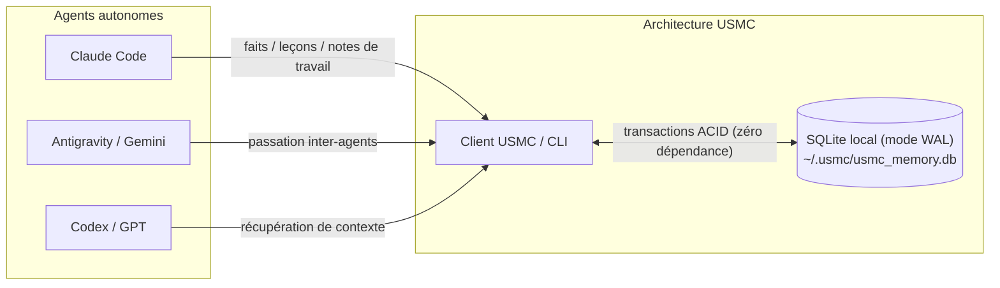

# USMC — United Shared Memory Client

[](https://github.com/ellmos-ai/usmc/actions/workflows/ci.yml)
[](#install-and-try)
[](.github/dependabot.yml)
[](LICENSE)
[](pyproject.toml)
[](#data-and-runtime-scope)
[-informational.svg)](#data-and-runtime-scope)

**Langues :** [English](README.md) · [Deutsch](README_de.md) · [Español](README_es.md) · [Français](README_fr.md) · [Português](README_pt.md) · [Русский](README_ru.md) · [简体中文](README_zh.md) · [日本語](README_ja.md) · [العربية](README_ar.md) · [हिन्दी](README_hi.md) · [বাংলা](README_bn.md)

<!-- lang-only: en,fr,pt,ru,zh,ja,ar,hi,bn -->
> Ce point d'entrée concis remplace l'ancien long `README.md` issu du [commit source `bf281f1`](https://github.com/ellmos-ai/usmc/blob/bf281f1d68e9e6af44db9d12588a000fac531a61/README.md). Son édition archivée corrigée est désormais [docs/archive/README.full.en.md](docs/archive/README.full.en.md) (en anglais) ; le commit lié conserve la révision source d'origine.
<!-- /lang-only -->

USMC est un paquet Python et une CLI qui enregistre des faits, des leçons apprises, des notes de travail et des passations de session dans SQLite. La liste déclarée des dépendances d'exécution directes est vide ; Python 3.10 ou une version ultérieure est requis.

<a id="data-and-runtime-scope"></a>
## Données et périmètre d'exécution

Par défaut, le chemin de la base de données est `~/.usmc/usmc_memory.db`. Définissez `USMC_DB` ou passez `--db` pour choisir un autre chemin ; les chemins personnalisés sont utilisés tels que fournis. USMC ne purge pas automatiquement les enregistrements stockés. Choisissez un chemin local approprié et gérez ses permissions, sauvegardes et durées de conservation selon votre cas d'usage.



Le code source examiné du paquet ne contient aucun client HTTP direct. L'installation depuis GitHub ou la construction du paquet utilise des outils disposant d'un accès réseau, et un agent appelant ou un autre processus peut utiliser le réseau indépendamment. USMC ne fournit ni pare-feu ni bac à sable (sandbox) ; les processus héritent des privilèges de leur processus lanceur.

<a id="install-and-try"></a>
## Installer et essayer

Installer depuis la source Git (cela nécessite des outils d'empaquetage Git/Python et un accès réseau) :

```console
python -m pip install "git+https://github.com/ellmos-ai/usmc.git"
usmc --help
usmc status
usmc setup --dry-run
```

Pour une copie locale, utilisez `python -m pip install -e ".[test]"`. L'extra `[test]` est destiné au développement et aux tests.

```python
from usmc import USMCClient

client = USMCClient(agent_id="codex")
client.add_fact("project", "status", "in progress", confidence=0.8)
print(client.generate_context())
```

## Documentation

- [Guide complet et exemples d'API (en anglais)](docs/archive/README.full.en.md)
- [Code de conduite](CODE_OF_CONDUCT.md)
- [Notes sur la sécurité et le traitement des données](SECURITY.md)
- [Contribution et commandes de test](CONTRIBUTING.md)
- [Inventaire des licences tierces](THIRD_PARTY_LICENSES.md) et [notes de licence en texte brut](THIRD_PARTY_LICENSES.txt)
- [Guide lisible par machine](llms.txt)
- [Journal des modifications](CHANGELOG.md)

## Projets associés

[BACH](https://github.com/ellmos-ai/bach) peut utiliser le schéma optionnel de mémoire partagée défini par `memory_union.contract.json` d'USMC ; consultez les détails de migration et d'activation dans le guide complet. Cela décrit une relation de schéma, et non une installation automatique ou une frontière de sécurité.
[ellmos-stack](https://github.com/ellmos-ai/ellmos-stack) intègre USMC comme composant de mémoire structurée dans une pile de recherche auto-hébergée ; son installateur récupère USMC depuis un commit Git épinglé. Cela décrit la composition de cette pile, et non une garantie d'installation ou de lancement fournie par USMC.
[GARDENER](https://github.com/ellmos-ai/gardener) propose des modèles sources optionnels en lecture seule pour des instantanés répliques d'USMC ; ils sont désactivés par défaut et nécessitent un instantané de synchronisation distinct ainsi qu'une activation explicite par l'appelant.

## Licence

Le projet est fourni sous la [licence MIT](LICENSE) ; les détails d'attribution figurent dans [NOTICE](NOTICE).

### Liens vers les sections archivées

<a id="sec-01"></a>
<a id="key-features"></a>
<a id="hauptmerkmale"></a>
<a id="características-principales"></a>
1. [Ouvrir la section archivée](docs/archive/README.full.en.md#sec-01)

<a id="sec-02"></a>
<a id="core-capabilities--primitives"></a>
<a id="kernkonzepte--primitive"></a>
<a id="conceptos-clave-y-primitivas"></a>
2. [Ouvrir la section archivée](docs/archive/README.full.en.md#sec-02)

<a id="sec-03"></a>
<a id="target-personas--discoverability"></a>
<a id="zielgruppen--auffindbarkeit"></a>
<a id="arquetipos-de-usuario--visibilidad"></a>
3. [Ouvrir la section archivée](docs/archive/README.full.en.md#sec-03)

<a id="sec-04"></a>
<a id="comparative-matrix-vs-alternatives"></a>
<a id="vergleichsmatrix-gegenueber-alternativen"></a>
<a id="matriz-comparativa-frente-a-alternativas"></a>
4. [Ouvrir la section archivée](docs/archive/README.full.en.md#sec-04)

<a id="sec-05"></a>
<a id="architecture--data-flow"></a>
<a id="architektur--datenfluss"></a>
<a id="arquitectura-y-flujo-de-datos"></a>
5. [Ouvrir la section archivée](docs/archive/README.full.en.md#sec-05)

<a id="sec-06"></a>
<a id="ascii-topology"></a>
<a id="ascii-topologie"></a>
<a id="topologia-ascii"></a>
6. [Ouvrir la section archivée](docs/archive/README.full.en.md#sec-06)

<a id="sec-07"></a>
<a id="multi-agent-interaction-sequence"></a>
<a id="multi-agenten-interaktionssequenz"></a>
<a id="secuencia-de-interacción-multi-agente"></a>
7. [Ouvrir la section archivée](docs/archive/README.full.en.md#sec-07)

<a id="sec-08"></a>
<a id="governance--runtime-invariants"></a>
<a id="governance--laufzeit-invarianten"></a>
<a id="invariantes-de-gobernanza-y-ejecución"></a>
8. [Ouvrir la section archivée](docs/archive/README.full.en.md#sec-08)

<a id="sec-09"></a>
<a id="quick-start"></a>
<a id="schnellstart"></a>
<a id="inicio-rápido"></a>
9. [Ouvrir la section archivée](docs/archive/README.full.en.md#sec-09)

<a id="sec-10"></a>
<a id="core-concepts--primitives"></a>
<a id="kernkonzepte--primitive-details"></a>
<a id="conceptos-clave-detalles"></a>
10. [Ouvrir la section archivée](docs/archive/README.full.en.md#sec-10)

<a id="sec-11"></a>
<a id="finding-things--advanced-filtering"></a>
<a id="gezieltes-suchen--filterung"></a>
<a id="búsqueda-precisa-y-filtros"></a>
11. [Ouvrir la section archivée](docs/archive/README.full.en.md#sec-11)

<a id="sec-12"></a>
<a id="multi-agent-session-coordination"></a>
<a id="multi-agenten-sitzungskoordination"></a>
<a id="coordinación-de-sesiones-multi-agente"></a>
12. [Ouvrir la section archivée](docs/archive/README.full.en.md#sec-12)

<a id="sec-13"></a>
<a id="runtime-language-contract"></a>
<a id="laufzeit-sprachvertrag"></a>
<a id="contrato-de-idioma-en-ejecución"></a>
13. [Ouvrir la section archivée](docs/archive/README.full.en.md#sec-13)

<a id="sec-14"></a>
<a id="database-schema--state-isolation"></a>
<a id="datenbankschema--status-isolation"></a>
<a id="esquema-de-base-de-datos-y-aislamiento"></a>
14. [Ouvrir la section archivée](docs/archive/README.full.en.md#sec-14)

<a id="sec-15"></a>
<a id="sibling-ecosystem--positioning"></a>
<a id="geschwister-oekosystem--positionierung"></a>
<a id="ecosistema-hermano-y-posicionamiento"></a>
15. [Ouvrir la section archivée](docs/archive/README.full.en.md#sec-15)

<a id="sec-16"></a>
<a id="testing--quality-gates"></a>
<a id="testen--qualitaetstore"></a>
<a id="pruebas-y-verificacion"></a>
16. [Ouvrir la section archivée](docs/archive/README.full.en.md#sec-16)

<a id="sec-17"></a>
<a id="third-party-licenses--transparency"></a>
<a id="drittanbieter-lizenzen--transparenz"></a>
<a id="licencias-de-terceros-y-transparencia"></a>
17. [Ouvrir la section archivée](docs/archive/README.full.en.md#sec-17)

<a id="sec-18"></a>
<a id="security-policy--liability"></a>
<a id="sicherheitsrichtlinie--haftung"></a>
<a id="politica-de-seguridad-y-responsabilidad"></a>
<a id="license--liability"></a>
<a id="lizenz--haftung"></a>
<a id="licencia-y-responsabilidad"></a>
<a id="security-policy--vulnerability-reporting"></a>
<a id="sicherheitsrichtlinie--meldewege"></a>
<a id="política-de-seguridad-y-reporte-de-vulnerabilidades"></a>
18. [Ouvrir la section archivée](docs/archive/README.full.en.md#sec-18)
