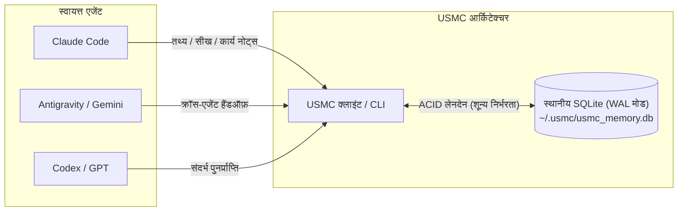

# USMC — United Shared Memory Client

[](https://github.com/ellmos-ai/usmc/actions/workflows/ci.yml)
[](#install-and-try)
[](.github/dependabot.yml)
[](LICENSE)
[](pyproject.toml)
[](#data-and-runtime-scope)
[-informational.svg)](#data-and-runtime-scope)

**भाषाएँ:** [English](README.md) · [Deutsch](README_de.md) · [Español](README_es.md) · [Français](README_fr.md) · [Português](README_pt.md) · [Русский](README_ru.md) · [简体中文](README_zh.md) · [日本語](README_ja.md) · [العربية](README_ar.md) · [हिन्दी](README_hi.md) · [বাংলা](README_bn.md)

<!-- lang-only: en,fr,pt,ru,zh,ja,ar,hi,bn -->
> यह संक्षिप्त प्रवेश बिंदु [स्रोत कमिट `bf281f1`](https://github.com/ellmos-ai/usmc/blob/bf281f1d68e9e6af44db9d12588a000fac531a61/README.md) में मौजूद पूर्व विस्तृत `README.md` का स्थान लेता है। इसका संशोधित संग्रहीत संस्करण अब [docs/archive/README.full.en.md](docs/archive/README.full.en.md) (अंग्रेज़ी में) में है; लिंक किया गया कमिट मूल स्रोत पुनरीक्षण को सुरक्षित रखता है।
<!-- /lang-only -->

USMC एक Python पैकेज और CLI है जो SQLite में तथ्य, सीख (lessons), कार्य नोट्स और सत्र हैंडऑफ़ संग्रहीत करता है। घोषित प्रत्यक्ष रनटाइम निर्भरता सूची खाली है; Python 3.10 या उससे नया संस्करण आवश्यक है।

<a id="data-and-runtime-scope"></a>
## डेटा और रनटाइम दायरा

डिफ़ॉल्ट रूप से, डेटाबेस पथ `~/.usmc/usmc_memory.db` है। कोई अन्य पथ चुनने के लिए `USMC_DB` सेट करें या `--db` पास करें; कस्टम पथ ठीक वैसे ही उपयोग किए जाते हैं जैसे दिए जाते हैं। USMC संग्रहीत रिकॉर्ड को स्वचालित रूप से नहीं हटाता (prune नहीं करता) है। एक उपयुक्त स्थानीय पथ चुनें और अपने उपयोग के अनुसार उसकी अनुमतियाँ, बैकअप और प्रतिधारण (retention) प्रबंधित करें।



समीक्षित पैकेज स्रोत में कोई प्रत्यक्ष HTTP क्लाइंट नहीं है। GitHub से इंस्टॉल करने या पैकेज बिल्ड करने में नेटवर्क-सक्षम टूल का उपयोग होता है, और कॉल करने वाला एजेंट या कोई अन्य प्रक्रिया स्वतंत्र रूप से नेटवर्क का उपयोग कर सकती है। USMC कोई फ़ायरवॉल या सैंडबॉक्स प्रदान नहीं करता है; प्रक्रियाएँ अपने लॉन्चर के विशेषाधिकार (privileges) विरासत में प्राप्त करती हैं।

<a id="install-and-try"></a>
## इंस्टॉल करें और आज़माएँ

Git स्रोत से इंस्टॉल करें (इसके लिए Git/Python पैकेजिंग टूल और नेटवर्क एक्सेस आवश्यक है):

```console
python -m pip install "git+https://github.com/ellmos-ai/usmc.git"
usmc --help
usmc status
usmc setup --dry-run
```

स्थानीय चेकआउट के लिए `python -m pip install -e ".[test]"` का उपयोग करें। `[test]` एक्स्ट्रा विकास और परीक्षण के लिए है।

```python
from usmc import USMCClient

client = USMCClient(agent_id="codex")
client.add_fact("project", "status", "in progress", confidence=0.8)
print(client.generate_context())
```

## दस्तावेज़ीकरण

- [पूर्ण मार्गदर्शिका और API उदाहरण](docs/archive/README.full.en.md) (अंग्रेज़ी में)
- [आचार संहिता](CODE_OF_CONDUCT.md)
- [सुरक्षा और डेटा-हैंडलिंग नोट्स](SECURITY.md)
- [योगदान और परीक्षण कमांड](CONTRIBUTING.md)
- [तृतीय-पक्ष लाइसेंस सूची](THIRD_PARTY_LICENSES.md) और [सादा-पाठ लाइसेंस नोट्स](THIRD_PARTY_LICENSES.txt)
- [मशीन-पठनीय मार्गदर्शिका](llms.txt)
- [परिवर्तन लॉग (Changelog)](CHANGELOG.md)

## संबंधित परियोजनाएँ

[BACH](https://github.com/ellmos-ai/bach) USMC के `memory_union.contract.json` द्वारा परिभाषित वैकल्पिक साझा-मेमोरी स्कीमा का उपयोग कर सकता है; माइग्रेशन और ऑप्ट-इन विवरण पूर्ण मार्गदर्शिका में देखें। यह केवल एक स्कीमा संबंध का वर्णन करता है, न कि स्वचालित इंस्टॉलेशन या सुरक्षा सीमा का।
[ellmos-stack](https://github.com/ellmos-ai/ellmos-stack) एक स्व-होस्टेड रिसर्च स्टैक में अपने क्यूरेटेड-मेमोरी घटक के रूप में USMC को शामिल करता है; इसका इंस्टॉलर एक पिन किए गए Git कमिट से USMC प्राप्त करता है। यह उस स्टैक की संरचना का वर्णन करता है, न कि USMC द्वारा प्रदान की गई किसी इंस्टॉलेशन या लॉन्च गारंटी का।
[GARDENER](https://github.com/ellmos-ai/gardener) USMC रेप्लिका स्नैपशॉट के लिए वैकल्पिक केवल-पठन (read-only) स्रोत टेम्पलेट प्रदान करता है; ये डिफ़ॉल्ट रूप से अक्षम होते हैं और इनके लिए एक अलग सिंक स्नैपशॉट तथा कॉलर द्वारा ऑप्ट-इन आवश्यक होता है।

## लाइसेंस

यह परियोजना [MIT लाइसेंस](LICENSE) के अंतर्गत प्रदान की गई है; एट्रिब्यूशन विवरण [NOTICE](NOTICE) में हैं।

### पुराने अनुभाग लिंक

<a id="sec-01"></a>
<a id="key-features"></a>
<a id="hauptmerkmale"></a>
<a id="características-principales"></a>
1. [संग्रहीत अनुभाग खोलें](docs/archive/README.full.en.md#sec-01)

<a id="sec-02"></a>
<a id="core-capabilities--primitives"></a>
<a id="kernkonzepte--primitive"></a>
<a id="conceptos-clave-y-primitivas"></a>
2. [संग्रहीत अनुभाग खोलें](docs/archive/README.full.en.md#sec-02)

<a id="sec-03"></a>
<a id="target-personas--discoverability"></a>
<a id="zielgruppen--auffindbarkeit"></a>
<a id="arquetipos-de-usuario--visibilidad"></a>
3. [संग्रहीत अनुभाग खोलें](docs/archive/README.full.en.md#sec-03)

<a id="sec-04"></a>
<a id="comparative-matrix-vs-alternatives"></a>
<a id="vergleichsmatrix-gegenueber-alternativen"></a>
<a id="matriz-comparativa-frente-a-alternativas"></a>
4. [संग्रहीत अनुभाग खोलें](docs/archive/README.full.en.md#sec-04)

<a id="sec-05"></a>
<a id="architecture--data-flow"></a>
<a id="architektur--datenfluss"></a>
<a id="arquitectura-y-flujo-de-datos"></a>
5. [संग्रहीत अनुभाग खोलें](docs/archive/README.full.en.md#sec-05)

<a id="sec-06"></a>
<a id="ascii-topology"></a>
<a id="ascii-topologie"></a>
<a id="topologia-ascii"></a>
6. [संग्रहीत अनुभाग खोलें](docs/archive/README.full.en.md#sec-06)

<a id="sec-07"></a>
<a id="multi-agent-interaction-sequence"></a>
<a id="multi-agenten-interaktionssequenz"></a>
<a id="secuencia-de-interacción-multi-agente"></a>
7. [संग्रहीत अनुभाग खोलें](docs/archive/README.full.en.md#sec-07)

<a id="sec-08"></a>
<a id="governance--runtime-invariants"></a>
<a id="governance--laufzeit-invarianten"></a>
<a id="invariantes-de-gobernanza-y-ejecución"></a>
8. [संग्रहीत अनुभाग खोलें](docs/archive/README.full.en.md#sec-08)

<a id="sec-09"></a>
<a id="quick-start"></a>
<a id="schnellstart"></a>
<a id="inicio-rápido"></a>
9. [संग्रहीत अनुभाग खोलें](docs/archive/README.full.en.md#sec-09)

<a id="sec-10"></a>
<a id="core-concepts--primitives"></a>
<a id="kernkonzepte--primitive-details"></a>
<a id="conceptos-clave-detalles"></a>
10. [संग्रहीत अनुभाग खोलें](docs/archive/README.full.en.md#sec-10)

<a id="sec-11"></a>
<a id="finding-things--advanced-filtering"></a>
<a id="gezieltes-suchen--filterung"></a>
<a id="búsqueda-precisa-y-filtros"></a>
11. [संग्रहीत अनुभाग खोलें](docs/archive/README.full.en.md#sec-11)

<a id="sec-12"></a>
<a id="multi-agent-session-coordination"></a>
<a id="multi-agenten-sitzungskoordination"></a>
<a id="coordinación-de-sesiones-multi-agente"></a>
12. [संग्रहीत अनुभाग खोलें](docs/archive/README.full.en.md#sec-12)

<a id="sec-13"></a>
<a id="runtime-language-contract"></a>
<a id="laufzeit-sprachvertrag"></a>
<a id="contrato-de-idioma-en-ejecución"></a>
13. [संग्रहीत अनुभाग खोलें](docs/archive/README.full.en.md#sec-13)

<a id="sec-14"></a>
<a id="database-schema--state-isolation"></a>
<a id="datenbankschema--status-isolation"></a>
<a id="esquema-de-base-de-datos-y-aislamiento"></a>
14. [संग्रहीत अनुभाग खोलें](docs/archive/README.full.en.md#sec-14)

<a id="sec-15"></a>
<a id="sibling-ecosystem--positioning"></a>
<a id="geschwister-oekosystem--positionierung"></a>
<a id="ecosistema-hermano-y-posicionamiento"></a>
15. [संग्रहीत अनुभाग खोलें](docs/archive/README.full.en.md#sec-15)

<a id="sec-16"></a>
<a id="testing--quality-gates"></a>
<a id="testen--qualitaetstore"></a>
<a id="pruebas-y-verificacion"></a>
16. [संग्रहीत अनुभाग खोलें](docs/archive/README.full.en.md#sec-16)

<a id="sec-17"></a>
<a id="third-party-licenses--transparency"></a>
<a id="drittanbieter-lizenzen--transparenz"></a>
<a id="licencias-de-terceros-y-transparencia"></a>
17. [संग्रहीत अनुभाग खोलें](docs/archive/README.full.en.md#sec-17)

<a id="sec-18"></a>
<a id="security-policy--liability"></a>
<a id="sicherheitsrichtlinie--haftung"></a>
<a id="politica-de-seguridad-y-responsabilidad"></a>
<a id="license--liability"></a>
<a id="lizenz--haftung"></a>
<a id="licencia-y-responsabilidad"></a>
<a id="security-policy--vulnerability-reporting"></a>
<a id="sicherheitsrichtlinie--meldewege"></a>
<a id="política-de-seguridad-y-reporte-de-vulnerabilidades"></a>
18. [संग्रहीत अनुभाग खोलें](docs/archive/README.full.en.md#sec-18)
