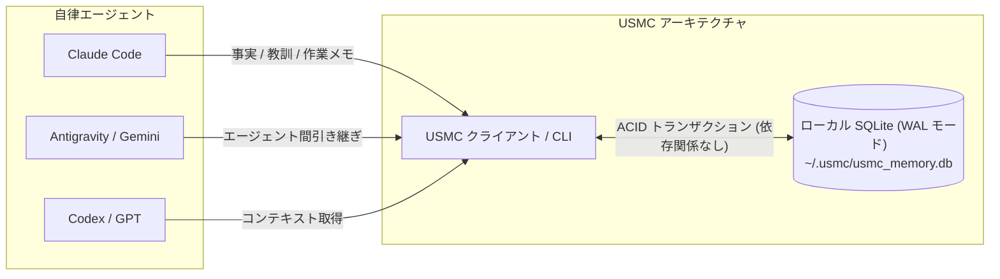

# USMC — United Shared Memory Client

[](https://github.com/ellmos-ai/usmc/actions/workflows/ci.yml)
[](#install-and-try)
[](.github/dependabot.yml)
[](LICENSE)
[](pyproject.toml)
[](#data-and-runtime-scope)
[-informational.svg)](#data-and-runtime-scope)

**言語:** [English](README.md) · [Deutsch](README_de.md) · [Español](README_es.md) · [Français](README_fr.md) · [Português](README_pt.md) · [Русский](README_ru.md) · [简体中文](README_zh.md) · [日本語](README_ja.md) · [العربية](README_ar.md) · [हिन्दी](README_hi.md) · [বাংলা](README_bn.md)

<!-- lang-only: en,fr,pt,ru,zh,ja,ar,hi,bn -->
> この簡潔なエントリーポイントは、[ソースコミット `bf281f1`](https://github.com/ellmos-ai/usmc/blob/bf281f1d68e9e6af44db9d12588a000fac531a61/README.md) にあった従来の長い `README.md` を置き換えるものです。修正済みのアーカイブ版は [docs/archive/README.full.en.md](docs/archive/README.full.en.md)（英語）にあり、リンク先のコミットには元のソースリビジョンが保持されています。
<!-- /lang-only -->

USMC は、事実（facts）、教訓（lessons）、作業メモ（working notes）、およびセッション引き継ぎ（session handoffs）を SQLite に保存する Python パッケージおよび CLI です。宣言されている直接のランタイム依存関係リストは空であり、Python 3.10 以降が必要です。

<a id="data-and-runtime-scope"></a>
## データとランタイム範囲

デフォルトのデータベースパスは `~/.usmc/usmc_memory.db` です。別のパスを指定するには `USMC_DB` を設定するか `--db` を渡してください。カスタムパスは指定されたとおりに使用されます。USMC は保存されたレコードを自動的に削除（プルーニング）しません。用途に適したローカルパスを選択し、権限、バックアップ、および保持期間を適切に管理してください。



レビュー済みのパッケージソースコードには直接的な HTTP クライアントは含まれていません。GitHub からのインストールやパッケージのビルドにはネットワーク対応ツールが使用され、呼び出し元のエージェントや他のプロセスが独立してネットワークを使用する場合があります。USMC はファイアウォールやサンドボックスを提供せず、プロセスは起動元の権限を継承します。

<a id="install-and-try"></a>
## インストールと試用

Git ソースからインストールします（これには Git／Python パッケージングツールおよびネットワークアクセスが必要です）：

```console
python -m pip install "git+https://github.com/ellmos-ai/usmc.git"
usmc --help
usmc status
```

ローカルチェックアウトの場合は `python -m pip install -e ".[test]"` を使用してください。`[test]` エクストラは開発およびテスト用です。

```python
from usmc import USMCClient

client = USMCClient(agent_id="codex")
client.add_fact("project", "status", "in progress", confidence=0.8)
print(client.generate_context())
```

## ドキュメント

- [完全ガイドと API 使用例](docs/archive/README.full.en.md)（英語）
- [行動規範](CODE_OF_CONDUCT.md)
- [セキュリティとデータ取り扱いに関する注記](SECURITY.md)
- [コントリビューションとテストコマンド](CONTRIBUTING.md)
- [サードパーティライセンス一覧](THIRD_PARTY_LICENSES.md) および [プレーンテキスト版ライセンス注記](THIRD_PARTY_LICENSES.txt)
- [機械可読ガイド](llms.txt)
- [変更履歴](CHANGELOG.md)

## 関連プロジェクト

[BACH](https://github.com/ellmos-ai/bach) は、USMC の `memory_union.contract.json` で定義されたオプションの共有メモリスキーマを利用できます。移行およびオプトインの詳細については完全ガイドを参照してください。これはスキーマ上の関係を示すものであり、自動インストールやセキュリティ境界を意味するものではありません。
[ellmos-stack](https://github.com/ellmos-ai/ellmos-stack) は、セルフホスト型リサーチスタックにおけるキュレーション済みメモリコンポーネントとして USMC を組み込んでおり、そのインストーラーは固定された Git コミットから USMC を取得します。これはスタックの構成を示すものであり、USMC が提供するインストールまたは起動保証ではありません。
[GARDENER](https://github.com/ellmos-ai/gardener) は、USMC レプリカスナップショット用のオプションの読み取り専用ソーステンプレートを提供します。これらはデフォルトで無効になっており、別途同期スナップショットとユーザーによるオプトインが必要です。

## ライセンス

本プロジェクトは [MIT License](LICENSE) の下で提供されています。帰属表示の詳細は [NOTICE](NOTICE) を参照してください。

### 旧セクションリンク

<a id="sec-01"></a>
<a id="key-features"></a>
<a id="hauptmerkmale"></a>
<a id="características-principales"></a>
1. [アーカイブされたセクションを開く](docs/archive/README.full.en.md#sec-01)

<a id="sec-02"></a>
<a id="core-capabilities--primitives"></a>
<a id="kernkonzepte--primitive"></a>
<a id="conceptos-clave-y-primitivas"></a>
2. [アーカイブされたセクションを開く](docs/archive/README.full.en.md#sec-02)

<a id="sec-03"></a>
<a id="target-personas--discoverability"></a>
<a id="zielgruppen--auffindbarkeit"></a>
<a id="arquetipos-de-usuario--visibilidad"></a>
3. [アーカイブされたセクションを開く](docs/archive/README.full.en.md#sec-03)

<a id="sec-04"></a>
<a id="comparative-matrix-vs-alternatives"></a>
<a id="vergleichsmatrix-gegenueber-alternativen"></a>
<a id="matriz-comparativa-frente-a-alternativas"></a>
4. [アーカイブされたセクションを開く](docs/archive/README.full.en.md#sec-04)

<a id="sec-05"></a>
<a id="architecture--data-flow"></a>
<a id="architektur--datenfluss"></a>
<a id="arquitectura-y-flujo-de-datos"></a>
5. [アーカイブされたセクションを開く](docs/archive/README.full.en.md#sec-05)

<a id="sec-06"></a>
<a id="ascii-topology"></a>
<a id="ascii-topologie"></a>
<a id="topologia-ascii"></a>
6. [アーカイブされたセクションを開く](docs/archive/README.full.en.md#sec-06)

<a id="sec-07"></a>
<a id="multi-agent-interaction-sequence"></a>
<a id="multi-agenten-interaktionssequenz"></a>
<a id="secuencia-de-interacción-multi-agente"></a>
7. [アーカイブされたセクションを開く](docs/archive/README.full.en.md#sec-07)

<a id="sec-08"></a>
<a id="governance--runtime-invariants"></a>
<a id="governance--laufzeit-invarianten"></a>
<a id="invariantes-de-gobernanza-y-ejecución"></a>
8. [アーカイブされたセクションを開く](docs/archive/README.full.en.md#sec-08)

<a id="sec-09"></a>
<a id="quick-start"></a>
<a id="schnellstart"></a>
<a id="inicio-rápido"></a>
9. [アーカイブされたセクションを開く](docs/archive/README.full.en.md#sec-09)

<a id="sec-10"></a>
<a id="core-concepts--primitives"></a>
<a id="kernkonzepte--primitive-details"></a>
<a id="conceptos-clave-detalles"></a>
10. [アーカイブされたセクションを開く](docs/archive/README.full.en.md#sec-10)

<a id="sec-11"></a>
<a id="finding-things--advanced-filtering"></a>
<a id="gezieltes-suchen--filterung"></a>
<a id="búsqueda-precisa-y-filtros"></a>
11. [アーカイブされたセクションを開く](docs/archive/README.full.en.md#sec-11)

<a id="sec-12"></a>
<a id="multi-agent-session-coordination"></a>
<a id="multi-agenten-sitzungskoordination"></a>
<a id="coordinación-de-sesiones-multi-agente"></a>
12. [アーカイブされたセクションを開く](docs/archive/README.full.en.md#sec-12)

<a id="sec-13"></a>
<a id="runtime-language-contract"></a>
<a id="laufzeit-sprachvertrag"></a>
<a id="contrato-de-idioma-en-ejecución"></a>
13. [アーカイブされたセクションを開く](docs/archive/README.full.en.md#sec-13)

<a id="sec-14"></a>
<a id="database-schema--state-isolation"></a>
<a id="datenbankschema--status-isolation"></a>
<a id="esquema-de-base-de-datos-y-aislamiento"></a>
14. [アーカイブされたセクションを開く](docs/archive/README.full.en.md#sec-14)

<a id="sec-15"></a>
<a id="sibling-ecosystem--positioning"></a>
<a id="geschwister-oekosystem--positionierung"></a>
<a id="ecosistema-hermano-y-posicionamiento"></a>
15. [アーカイブされたセクションを開く](docs/archive/README.full.en.md#sec-15)

<a id="sec-16"></a>
<a id="testing--quality-gates"></a>
<a id="testen--qualitaetstore"></a>
<a id="pruebas-y-verificacion"></a>
16. [アーカイブされたセクションを開く](docs/archive/README.full.en.md#sec-16)

<a id="sec-17"></a>
<a id="third-party-licenses--transparency"></a>
<a id="drittanbieter-lizenzen--transparenz"></a>
<a id="licencias-de-terceros-y-transparencia"></a>
17. [アーカイブされたセクションを開く](docs/archive/README.full.en.md#sec-17)

<a id="sec-18"></a>
<a id="security-policy--liability"></a>
<a id="sicherheitsrichtlinie--haftung"></a>
<a id="politica-de-seguridad-y-responsabilidad"></a>
<a id="license--liability"></a>
<a id="lizenz--haftung"></a>
<a id="licencia-y-responsabilidad"></a>
<a id="security-policy--vulnerability-reporting"></a>
<a id="sicherheitsrichtlinie--meldewege"></a>
<a id="política-de-seguridad-y-reporte-de-vulnerabilidades"></a>
18. [アーカイブされたセクションを開く](docs/archive/README.full.en.md#sec-18)
