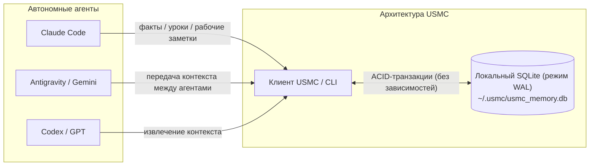

# USMC — United Shared Memory Client

[](https://github.com/ellmos-ai/usmc/actions/workflows/ci.yml)
[](#install-and-try)
[](.github/dependabot.yml)
[](LICENSE)
[](pyproject.toml)
[](#data-and-runtime-scope)
[-informational.svg)](#data-and-runtime-scope)

**Языки:** [English](README.md) · [Deutsch](README_de.md) · [Español](README_es.md) · [Français](README_fr.md) · [Português](README_pt.md) · [Русский](README_ru.md) · [简体中文](README_zh.md) · [日本語](README_ja.md) · [العربية](README_ar.md) · [हिन्दी](README_hi.md) · [বাংলা](README_bn.md)

<!-- lang-only: en,fr,pt,ru,zh,ja,ar,hi,bn -->
> Эта краткая стартовая страница заменяет прежний длинный файл `README.md` из [исходного коммита `bf281f1`](https://github.com/ellmos-ai/usmc/blob/bf281f1d68e9e6af44db9d12588a000fac531a61/README.md). Его исправленная архивная редакция теперь находится в [docs/archive/README.full.en.md](docs/archive/README.full.en.md) (на английском языке); ссылка на коммит сохраняет первоначальную версию.
<!-- /lang-only -->

USMC — это пакет Python и CLI, который хранит факты, извлечённые уроки, рабочие заметки и передачи состояния сессий в SQLite. Объявленный список прямых зависимостей времени выполнения пуст; требуется Python 3.10 или новее.

<a id="data-and-runtime-scope"></a>
## Данные и область выполнения

По умолчанию путь к базе данных — `~/.usmc/usmc_memory.db`. Задайте `USMC_DB` или передайте `--db`, чтобы выбрать другой путь; пользовательские пути используются так, как они указаны. USMC не удаляет сохранённые записи автоматически. Выберите подходящий локальный путь и управляйте его правами доступа, резервными копиями и сроком хранения в соответствии с вашим сценарием использования.



Проверенный исходный код пакета не содержит прямого HTTP-клиента. Установка из GitHub или сборка пакета используют инструменты с доступом к сети, а вызывающий агент или другой процесс могут использовать сеть независимо. USMC не предоставляет межсетевой экран или песочницу (sandbox); процессы наследуют привилегии запустившего их процесса.

<a id="install-and-try"></a>
## Установка и запуск

Установка из Git-репозитория (требуются инструменты Git/пакетирования Python и доступ к сети):

```console
python -m pip install "git+https://github.com/ellmos-ai/usmc.git"
usmc --help
usmc status
usmc setup --dry-run
```

Для локальной копии используйте `python -m pip install -e ".[test]"`. Дополнительная группа `[test]` предназначена для разработки и тестирования.

```python
from usmc import USMCClient

client = USMCClient(agent_id="codex")
client.add_fact("project", "status", "in progress", confidence=0.8)
print(client.generate_context())
```

## Документация

- [Полное руководство и примеры API (на английском языке)](docs/archive/README.full.en.md)
- [Кодекс поведения](CODE_OF_CONDUCT.md)
- [Заметки по безопасности и обработке данных](SECURITY.md)
- [Участие в разработке и команды тестирования](CONTRIBUTING.md)
- [Список лицензий сторонних компонентов](THIRD_PARTY_LICENSES.md) и [текстовые примечания к лицензиям](THIRD_PARTY_LICENSES.txt)
- [Машиночитаемое руководство](llms.txt)
- [Журнал изменений](CHANGELOG.md)

## Связанные проекты

[BACH](https://github.com/ellmos-ai/bach) может использовать опциональную схему общей памяти, определённую в файле `memory_union.contract.json` проекта USMC; подробности миграции и подключения см. в полном руководстве. Это описывает связь на уровне схемы данных, а не автоматическую установку или границу безопасности.
[ellmos-stack](https://github.com/ellmos-ai/ellmos-stack) включает USMC как компонент курируемой памяти в автономный исследовательский стек; его установщик загружает USMC из зафиксированного Git-коммита. Это описывает состав данного стека, а не гарантию установки или запуска со стороны USMC.
[GARDENER](https://github.com/ellmos-ai/gardener) предоставляет опциональные шаблоны источников только для чтения для снимков-реплик USMC; они отключены по умолчанию и требуют отдельного снимка синхронизации и явного включения со стороны вызывающей стороны.

## Лицензия

Проект распространяется под [лицензией MIT](LICENSE); сведения об авторстве указаны в файле [NOTICE](NOTICE).

### Ссылки на предыдущие разделы

<a id="sec-01"></a>
<a id="key-features"></a>
<a id="hauptmerkmale"></a>
<a id="características-principales"></a>
1. [Открыть архивный раздел](docs/archive/README.full.en.md#sec-01)

<a id="sec-02"></a>
<a id="core-capabilities--primitives"></a>
<a id="kernkonzepte--primitive"></a>
<a id="conceptos-clave-y-primitivas"></a>
2. [Открыть архивный раздел](docs/archive/README.full.en.md#sec-02)

<a id="sec-03"></a>
<a id="target-personas--discoverability"></a>
<a id="zielgruppen--auffindbarkeit"></a>
<a id="arquetipos-de-usuario--visibilidad"></a>
3. [Открыть архивный раздел](docs/archive/README.full.en.md#sec-03)

<a id="sec-04"></a>
<a id="comparative-matrix-vs-alternatives"></a>
<a id="vergleichsmatrix-gegenueber-alternativen"></a>
<a id="matriz-comparativa-frente-a-alternativas"></a>
4. [Открыть архивный раздел](docs/archive/README.full.en.md#sec-04)

<a id="sec-05"></a>
<a id="architecture--data-flow"></a>
<a id="architektur--datenfluss"></a>
<a id="arquitectura-y-flujo-de-datos"></a>
5. [Открыть архивный раздел](docs/archive/README.full.en.md#sec-05)

<a id="sec-06"></a>
<a id="ascii-topology"></a>
<a id="ascii-topologie"></a>
<a id="topologia-ascii"></a>
6. [Открыть архивный раздел](docs/archive/README.full.en.md#sec-06)

<a id="sec-07"></a>
<a id="multi-agent-interaction-sequence"></a>
<a id="multi-agenten-interaktionssequenz"></a>
<a id="secuencia-de-interacción-multi-agente"></a>
7. [Открыть архивный раздел](docs/archive/README.full.en.md#sec-07)

<a id="sec-08"></a>
<a id="governance--runtime-invariants"></a>
<a id="governance--laufzeit-invarianten"></a>
<a id="invariantes-de-gobernanza-y-ejecución"></a>
8. [Открыть архивный раздел](docs/archive/README.full.en.md#sec-08)

<a id="sec-09"></a>
<a id="quick-start"></a>
<a id="schnellstart"></a>
<a id="inicio-rápido"></a>
9. [Открыть архивный раздел](docs/archive/README.full.en.md#sec-09)

<a id="sec-10"></a>
<a id="core-concepts--primitives"></a>
<a id="kernkonzepte--primitive-details"></a>
<a id="conceptos-clave-detalles"></a>
10. [Открыть архивный раздел](docs/archive/README.full.en.md#sec-10)

<a id="sec-11"></a>
<a id="finding-things--advanced-filtering"></a>
<a id="gezieltes-suchen--filterung"></a>
<a id="búsqueda-precisa-y-filtros"></a>
11. [Открыть архивный раздел](docs/archive/README.full.en.md#sec-11)

<a id="sec-12"></a>
<a id="multi-agent-session-coordination"></a>
<a id="multi-agenten-sitzungskoordination"></a>
<a id="coordinación-de-sesiones-multi-agente"></a>
12. [Открыть архивный раздел](docs/archive/README.full.en.md#sec-12)

<a id="sec-13"></a>
<a id="runtime-language-contract"></a>
<a id="laufzeit-sprachvertrag"></a>
<a id="contrato-de-idioma-en-ejecución"></a>
13. [Открыть архивный раздел](docs/archive/README.full.en.md#sec-13)

<a id="sec-14"></a>
<a id="database-schema--state-isolation"></a>
<a id="datenbankschema--status-isolation"></a>
<a id="esquema-de-base-de-datos-y-aislamiento"></a>
14. [Открыть архивный раздел](docs/archive/README.full.en.md#sec-14)

<a id="sec-15"></a>
<a id="sibling-ecosystem--positioning"></a>
<a id="geschwister-oekosystem--positionierung"></a>
<a id="ecosistema-hermano-y-posicionamiento"></a>
15. [Открыть архивный раздел](docs/archive/README.full.en.md#sec-15)

<a id="sec-16"></a>
<a id="testing--quality-gates"></a>
<a id="testen--qualitaetstore"></a>
<a id="pruebas-y-verificacion"></a>
16. [Открыть архивный раздел](docs/archive/README.full.en.md#sec-16)

<a id="sec-17"></a>
<a id="third-party-licenses--transparency"></a>
<a id="drittanbieter-lizenzen--transparenz"></a>
<a id="licencias-de-terceros-y-transparencia"></a>
17. [Открыть архивный раздел](docs/archive/README.full.en.md#sec-17)

<a id="sec-18"></a>
<a id="security-policy--liability"></a>
<a id="sicherheitsrichtlinie--haftung"></a>
<a id="politica-de-seguridad-y-responsabilidad"></a>
<a id="license--liability"></a>
<a id="lizenz--haftung"></a>
<a id="licencia-y-responsabilidad"></a>
<a id="security-policy--vulnerability-reporting"></a>
<a id="sicherheitsrichtlinie--meldewege"></a>
<a id="política-de-seguridad-y-reporte-de-vulnerabilidades"></a>
18. [Открыть архивный раздел](docs/archive/README.full.en.md#sec-18)
