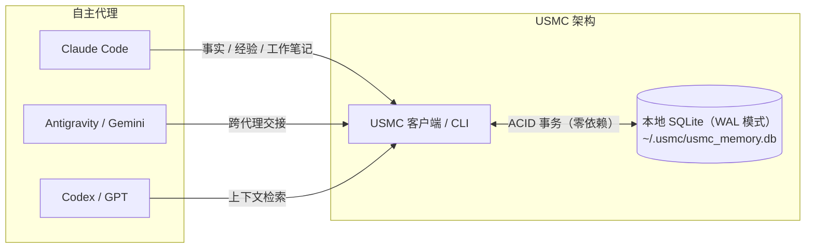

# USMC — United Shared Memory Client

[](https://github.com/ellmos-ai/usmc/actions/workflows/ci.yml)
[](#install-and-try)
[](.github/dependabot.yml)
[](LICENSE)
[](pyproject.toml)
[](#data-and-runtime-scope)
[-informational.svg)](#data-and-runtime-scope)

**语言：** [English](README.md) · [Deutsch](README_de.md) · [Español](README_es.md) · [Français](README_fr.md) · [Português](README_pt.md) · [Русский](README_ru.md) · [简体中文](README_zh.md) · [日本語](README_ja.md) · [العربية](README_ar.md) · [हिन्दी](README_hi.md) · [বাংলা](README_bn.md)

<!-- lang-only: en,fr,pt,ru,zh,ja,ar,hi,bn -->
> 本精简入口文档取代了来自[源提交 `bf281f1`](https://github.com/ellmos-ai/usmc/blob/bf281f1d68e9e6af44db9d12588a000fac531a61/README.md) 的旧版长篇 `README.md`。其经过修订的归档版本现位于 [docs/archive/README.full.en.md](docs/archive/README.full.en.md)（英文）；所链接的提交保留了原始修订版本。
<!-- /lang-only -->

USMC 是一个 Python 包和命令行工具（CLI），用于在 SQLite 中存储事实、经验教训、工作笔记和会话交接记录。其声明的直接运行时依赖列表为空；需要 Python 3.10 或更高版本。

<a id="data-and-runtime-scope"></a>
## 数据与运行时范围

默认情况下，数据库路径为 `~/.usmc/usmc_memory.db`。可通过设置 `USMC_DB` 或传入 `--db` 来指定其他路径；自定义路径将按传入原样使用。USMC 不会自动清理已存储的记录。请根据你的使用场景选择合适的本地路径，并自行管理其权限、备份与保留策略。



经审查的软件包源码中不包含直接的 HTTP 客户端。从 GitHub 安装或构建软件包会使用具备网络能力的工具，而调用方代理或其他进程也可能独立使用网络。USMC 不提供防火墙或沙箱；进程将继承其启动者的权限。

<a id="install-and-try"></a>
## 安装与试用

从 Git 源码安装（需要 Git/Python 打包工具及网络访问权限）：

```console
python -m pip install "git+https://github.com/ellmos-ai/usmc.git"
usmc --help
usmc status
usmc setup --dry-run
```

对于本地检出代码，请使用 `python -m pip install -e ".[test]"`。`[test]` 可选依赖组用于开发和测试。

```python
from usmc import USMCClient

client = USMCClient(agent_id="codex")
client.add_fact("project", "status", "in progress", confidence=0.8)
print(client.generate_context())
```

## 文档

- [完整指南与 API 示例（英文）](docs/archive/README.full.en.md)
- [行为准则](CODE_OF_CONDUCT.md)
- [安全与数据处理说明](SECURITY.md)
- [贡献指南与测试命令](CONTRIBUTING.md)
- [第三方许可证清单](THIRD_PARTY_LICENSES.md)与[纯文本许可证说明](THIRD_PARTY_LICENSES.txt)
- [机器可读指南](llms.txt)
- [更新日志](CHANGELOG.md)

## 相关项目

[BACH](https://github.com/ellmos-ai/bach) 可以使用 USMC 的 `memory_union.contract.json` 所定义的可选共享内存模式；迁移与启用详情请参阅完整指南。这描述的是一种模式（Schema）关系，而非自动安装或安全边界。
[ellmos-stack](https://github.com/ellmos-ai/ellmos-stack) 将 USMC 作为其精选记忆组件集成到自托管研究技术栈中；其安装程序会从固定的 Git 提交拉取 USMC。这描述的是该技术栈的组合方式，而非 USMC 提供的安装或启动保证。
[GARDENER](https://github.com/ellmos-ai/gardener) 为 USMC 副本快照提供可选的只读源模板；这些模板默认处于禁用状态，需要单独的同步快照以及调用方的显式启用。

## 许可证

本项目依据 [MIT 许可证](LICENSE)提供；署名详情见 [NOTICE](NOTICE)。

### 历史章节链接

<a id="sec-01"></a>
<a id="key-features"></a>
<a id="hauptmerkmale"></a>
<a id="características-principales"></a>
1. [打开归档章节](docs/archive/README.full.en.md#sec-01)

<a id="sec-02"></a>
<a id="core-capabilities--primitives"></a>
<a id="kernkonzepte--primitive"></a>
<a id="conceptos-clave-y-primitivas"></a>
2. [打开归档章节](docs/archive/README.full.en.md#sec-02)

<a id="sec-03"></a>
<a id="target-personas--discoverability"></a>
<a id="zielgruppen--auffindbarkeit"></a>
<a id="arquetipos-de-usuario--visibilidad"></a>
3. [打开归档章节](docs/archive/README.full.en.md#sec-03)

<a id="sec-04"></a>
<a id="comparative-matrix-vs-alternatives"></a>
<a id="vergleichsmatrix-gegenueber-alternativen"></a>
<a id="matriz-comparativa-frente-a-alternativas"></a>
4. [打开归档章节](docs/archive/README.full.en.md#sec-04)

<a id="sec-05"></a>
<a id="architecture--data-flow"></a>
<a id="architektur--datenfluss"></a>
<a id="arquitectura-y-flujo-de-datos"></a>
5. [打开归档章节](docs/archive/README.full.en.md#sec-05)

<a id="sec-06"></a>
<a id="ascii-topology"></a>
<a id="ascii-topologie"></a>
<a id="topologia-ascii"></a>
6. [打开归档章节](docs/archive/README.full.en.md#sec-06)

<a id="sec-07"></a>
<a id="multi-agent-interaction-sequence"></a>
<a id="multi-agenten-interaktionssequenz"></a>
<a id="secuencia-de-interacción-multi-agente"></a>
7. [打开归档章节](docs/archive/README.full.en.md#sec-07)

<a id="sec-08"></a>
<a id="governance--runtime-invariants"></a>
<a id="governance--laufzeit-invarianten"></a>
<a id="invariantes-de-gobernanza-y-ejecución"></a>
8. [打开归档章节](docs/archive/README.full.en.md#sec-08)

<a id="sec-09"></a>
<a id="quick-start"></a>
<a id="schnellstart"></a>
<a id="inicio-rápido"></a>
9. [打开归档章节](docs/archive/README.full.en.md#sec-09)

<a id="sec-10"></a>
<a id="core-concepts--primitives"></a>
<a id="kernkonzepte--primitive-details"></a>
<a id="conceptos-clave-detalles"></a>
10. [打开归档章节](docs/archive/README.full.en.md#sec-10)

<a id="sec-11"></a>
<a id="finding-things--advanced-filtering"></a>
<a id="gezieltes-suchen--filterung"></a>
<a id="búsqueda-precisa-y-filtros"></a>
11. [打开归档章节](docs/archive/README.full.en.md#sec-11)

<a id="sec-12"></a>
<a id="multi-agent-session-coordination"></a>
<a id="multi-agenten-sitzungskoordination"></a>
<a id="coordinación-de-sesiones-multi-agente"></a>
12. [打开归档章节](docs/archive/README.full.en.md#sec-12)

<a id="sec-13"></a>
<a id="runtime-language-contract"></a>
<a id="laufzeit-sprachvertrag"></a>
<a id="contrato-de-idioma-en-ejecución"></a>
13. [打开归档章节](docs/archive/README.full.en.md#sec-13)

<a id="sec-14"></a>
<a id="database-schema--state-isolation"></a>
<a id="datenbankschema--status-isolation"></a>
<a id="esquema-de-base-de-datos-y-aislamiento"></a>
14. [打开归档章节](docs/archive/README.full.en.md#sec-14)

<a id="sec-15"></a>
<a id="sibling-ecosystem--positioning"></a>
<a id="geschwister-oekosystem--positionierung"></a>
<a id="ecosistema-hermano-y-posicionamiento"></a>
15. [打开归档章节](docs/archive/README.full.en.md#sec-15)

<a id="sec-16"></a>
<a id="testing--quality-gates"></a>
<a id="testen--qualitaetstore"></a>
<a id="pruebas-y-verificacion"></a>
16. [打开归档章节](docs/archive/README.full.en.md#sec-16)

<a id="sec-17"></a>
<a id="third-party-licenses--transparency"></a>
<a id="drittanbieter-lizenzen--transparenz"></a>
<a id="licencias-de-terceros-y-transparencia"></a>
17. [打开归档章节](docs/archive/README.full.en.md#sec-17)

<a id="sec-18"></a>
<a id="security-policy--liability"></a>
<a id="sicherheitsrichtlinie--haftung"></a>
<a id="politica-de-seguridad-y-responsabilidad"></a>
<a id="license--liability"></a>
<a id="lizenz--haftung"></a>
<a id="licencia-y-responsabilidad"></a>
<a id="security-policy--vulnerability-reporting"></a>
<a id="sicherheitsrichtlinie--meldewege"></a>
<a id="política-de-seguridad-y-reporte-de-vulnerabilidades"></a>
18. [打开归档章节](docs/archive/README.full.en.md#sec-18)
