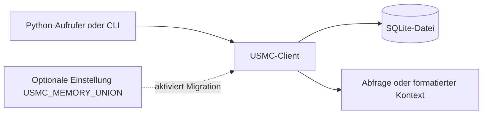

# USMC — United Shared Memory Client

> Korrigierte Archivfassung vom 12.10.2026. Direkter Vorgänger: die frühere lange `README_de.md`, die nun durch den kompakten Einstieg [`../../README_de.md`](../../README_de.md) und diesen ausführlichen Leitfaden unter `docs/archive/README.full.de.md` repräsentiert wird. Die Quellfassung ist [Commit `bf281f1`](https://github.com/ellmos-ai/usmc/blob/bf281f1d68e9e6af44db9d12588a000fac531a61/README_de.md); diese Fassung ist korrigiert und keine unveränderte Kopie.

[English](../../README.md) | [Deutsch](../../README_de.md) | [Español](../../README_es.md)

Dieser Leitfaden beschreibt Quellcode und deklarierte Metadaten der verlinkten Revision. Für spätere Änderungen gelten aktueller Einstieg, Quellcode und Workflows.

## Inhalt

1. [Projektumfang und Paketdaten](#sec-01)
2. [Gespeicherte Datensätze](#sec-02)
3. [Typische Nutzung](#sec-03)
4. [Entwurfsentscheidungen](#sec-04)
5. [Datenfluss](#sec-05)
6. [Speicherübersicht](#sec-06)
7. [Eine Datenbank aus mehreren Prozessen nutzen](#sec-07)
8. [Grenzen und Zuständigkeiten](#sec-08)
9. [Schnellstart](#sec-09)
10. [Datensatzarten](#sec-10)
11. [Filter und Abfragen](#sec-11)
12. [Sitzungen und Übergaben](#sec-12)
13. [Sprache und CLI](#sec-13)
14. [Datenbankpfad und gemeinsames Schema](#sec-14)
15. [Verwandtes Projekt](#sec-15)
16. [Entwicklungsprüfungen](#sec-16)
17. [Lizenzinventar](#sec-17)
18. [Sicherheit, Datenschutz und rechtlicher Umfang](#sec-18)

<a id="sec-01"></a>
<a id="hauptmerkmale"></a>
<a id="key-features"></a>
<a id="características-principales"></a>
## 1. Projektumfang und Paketdaten

USMC ist ein Python-Paket und Kommandozeilen-Client für strukturierte Agentennotizen in SQLite. Die deklarierte direkte Laufzeit-Abhängigkeitsliste ist leer (`dependencies=[]`); unterstützt wird Python 3.10 oder neuer. Git-Checkout, Build-Backend und Testwerkzeuge haben eigene Netzwerk- und Lizenzumfänge.

Das Projekt ist nicht mit dem United States Marine Corps verbunden.

<a id="sec-02"></a>
<a id="kernkonzepte--primitive"></a>
<a id="core-capabilities--primitives"></a>
<a id="conceptos-clave-y-primitivas"></a>
## 2. Gespeicherte Datensätze

| Datensatz | Zweck |
|---|---|
| Fakten | Kategorie/Schlüssel/Wert mit Konfidenz und Agentenkennung. |
| Lessons Learned | Problem, Lösung, Schweregrad und Quellenmetadaten. |
| Arbeitsnotizen | Kurze Einträge mit Typ, Priorität, optionalen Tags und Sitzungskontext. |
| Sitzungen | Beginn/Ende und Übergabenotizen. |

Diese Datenfunktionen setzen keine Richtlinie für aufrufende Prozesse durch.

<a id="sec-03"></a>
<a id="zielgruppen--auffindbarkeit"></a>
<a id="target-personas--discoverability"></a>
<a id="arquetipos-de-usuario--visibilidad"></a>
## 3. Typische Nutzung

Ein Aufrufer kann einen Client öffnen, einen Datensatz schreiben, ihn abfragen und Kontext für den eigenen Prompt formatieren:

```python
from usmc import USMCClient

client = USMCClient(agent_id="codex")
client.add_fact("project", "status", "in Arbeit", confidence=0.8)
client.add_working("Migrationspfad prüfen", tags="sqlite,review")
print(client.generate_context())
```

`usmc --help` zeigt die installierten CLI-Befehle. Der Console-Einstieg ist in `pyproject.toml` deklariert.

<a id="sec-04"></a>
<a id="vergleichsmatrix-gegenueber-alternativen"></a>
<a id="comparative-matrix-vs-alternatives"></a>
<a id="matriz-comparativa-frente-a-alternativas"></a>
## 4. Entwurfsentscheidungen

USMC speichert den Zustand in einer SQLite-Datenbank und verwendet SQLite-Transaktionen und den WAL-Modus. Für die Standardnutzung ist kein separater Datenbankserver erforderlich. Aufrufer können einen eigenen Datenbankpfad wählen und bleiben für Zugriffskoordination, Sicherungen und Aufbewahrung zuständig. Leistung hängt unter anderem von Hardware, SQLite-Version, Datenbankgröße und Arbeitslast ab; ältere Benchmarkwerte sind keine aktuelle Zusage.

<a id="sec-05"></a>
<a id="architektur--datenfluss"></a>
<a id="architecture--data-flow"></a>
<a id="arquitectura-y-flujo-de-datos"></a>
## 5. Datenfluss

Vereinfachter Datenfluss:



Das Diagramm beschreibt Paketaufrufe und lokale Speicherung. Es beschreibt weder eine Host-Firewall noch eine Änderung von Betriebssystemrechten oder einen Netzwerkdienst.

<a id="sec-06"></a>
<a id="ascii-topologie"></a>
<a id="ascii-topology"></a>
<a id="topologia-ascii"></a>
## 6. Speicherübersicht

```text
Aufrufer / installierte CLI
        |
        v
USMC-Pythonpaket ---- liest/schreibt ----> gewählter SQLite-Datenbankpfad
        |
        +---- gibt Datensätze oder formatierten Kontext zurück

Python-/Git-Paketinstallation und andere Aufruferprozesse liegen außerhalb dieses lokalen Datenflusses.
```

<a id="sec-07"></a>
<a id="multi-agenten-interaktionssequenz"></a>
<a id="multi-agent-interaction-sequence"></a>
<a id="secuencia-de-interacción-multi-agente"></a>
## 7. Eine Datenbank aus mehreren Prozessen nutzen

Mehrere Prozesse können dieselbe SQLite-Datei öffnen. SQLite liefert sein dokumentiertes Transaktions- und Sperrverhalten; Agentenkennungen markieren Datensätze und authentifizieren keine Prozesse oder erzwingen eine Ein-Schreiber-Sperre. Anwendungen entscheiden selbst, welche Prozesse auf die Datei zugreifen und wie sie ihren Ablauf koordinieren.

<a id="sec-08"></a>
<a id="governance--laufzeit-invarianten"></a>
<a id="governance--runtime-invariants"></a>
<a id="invariantes-de-gobernanza-y-ejecución"></a>
## 8. Grenzen und Zuständigkeiten

| Bereich | Durch den Quellstand belegter Umfang |
|---|---|
| Laufzeit-Abhängigkeiten | `pyproject.toml` deklariert keine direkten Projekt-Laufzeitabhängigkeiten; Pythons Standardbibliothek enthält `sqlite3`. |
| Datenbankpfad | Standard `~/.usmc/usmc_memory.db`; `USMC_DB` und `--db` können einen anderen Pfad setzen. |
| Netzwerk | Die geprüften Paketmodule enthalten keinen direkten HTTP-Client. Git-/pip-/Build-Werkzeuge und Aufrufer können das Netzwerk nutzen. |
| Prozessrechte | USMC senkt oder erhöht keine Rechte; es läuft mit den Rechten des gestarteten Prozesses. |
| Aufbewahrung | Das Paket löscht Datensätze nicht automatisch. |
| Sicherheitszusage | Hier werden weder Firewall, Sandbox, Verschlüsselung, Zertifizierung noch ein vollständiges Abhängigkeits-/Lizenzaudit behauptet. |

Die Angaben beschreiben den geprüften Quellstand und die deklarierten Metadaten, nicht jede Installation oder jeden Aufrufer.

<a id="sec-09"></a>
<a id="schnellstart"></a>
<a id="quick-start"></a>
<a id="inicio-rápido"></a>
## 9. Schnellstart

Aus dem Quellrepository mit Git und einer Python-Paketumgebung:

```console
python -m pip install "git+https://github.com/ellmos-ai/usmc.git"
usmc --help
```

Für einen Checkout:

```console
python -m pip install -e ".[test]"
```

Die Installation aus Git benötigt Netzwerkzugriff. Die direkte Laufzeit-Abhängigkeitsliste ist leer; pip kann trotzdem Build-Werkzeuge benötigen.

```python
from usmc import USMCClient

client = USMCClient(agent_id="codex")
client.add_fact("project", "framework", "FastAPI", confidence=0.9)
client.add_lesson(
    title="Windows-Kodierung",
    problem="Subprocess-Ausgabe nutzte die falsche Kodierung",
    solution="Subprocess-Kodierung ausdrücklich konfigurieren",
    severity="high",
)
client.add_working("Paketmetadaten prüfen", tags="docs,release")
print(client.generate_context())
```

Die Standarddatenbank liegt unter `~/.usmc/usmc_memory.db`. `USMC_DB` oder die globale Option `--db` wählt einen anderen Ort.

<a id="sec-10"></a>
<a id="kernkonzepte--primitive-details"></a>
<a id="conceptos-clave-detalles"></a>
## 10. Datensatzarten

Der Client stellt Fakten, Lessons Learned, Arbeitsnotizen und Sitzungsdatensätze bereit. Fakten verwenden Kategorie, Schlüssel, Wert und Agentenkennung; Lessons enthalten Problem/Lösung und Schweregrad; Arbeitsnotizen unterstützen Tags; Sitzungen halten Aufgabe und Übergabenotizen fest. Aktuelle Felder stehen in Python-Docstrings und CLI-Hilfe.

<a id="sec-11"></a>
<a id="gezieltes-suchen--filterung"></a>
<a id="finding-things--advanced-filtering"></a>
<a id="búsqueda-precisa-y-filtros"></a>
## 11. Filter und Abfragen

Die CLI bietet je nach Datensatzbefehl Filter nach Kategorie, Agent, Schweregrad, Tag und Teilzeichenfolge:

```console
usmc facts --category project
usmc working --tags docs,release --tags-all
usmc lessons --severity high --grep encoding
```

Die Filteroptionen unterscheiden sich je Befehl. Aktuelle Syntax: `usmc facts --help`, `usmc working --help` und `usmc lessons --help`.

<a id="sec-12"></a>
<a id="multi-agenten-sitzungskoordination"></a>
<a id="multi-agent-session-coordination"></a>
<a id="coordinación-de-sesiones-multi-agente"></a>
## 12. Sitzungen und Übergaben

Ein `USMCClient` nimmt eine `agent_id` als Kennzeichnung entgegen. Verschiedene Prozesse können unterschiedliche Kennungen nutzen und dieselbe Datenbankdatei öffnen; die Kennung ist ein Datenfeld und keine Identitätsprüfung. SQLite koordiniert den Dateizugriff, während Zugriffsschutz und Ablaufentscheidungen bei der Anwendung bleiben.

<a id="sec-13"></a>
<a id="laufzeit-sprachvertrag"></a>
<a id="runtime-language-contract"></a>
<a id="contrato-de-idioma-en-ejecución"></a>
## 13. Sprache und CLI

Die Python-API stellt `RUNTIME_LANGUAGE = "de"` bereit. CLI-Befehle und maschinenlesbare Schlüssel sind englische Tokens; benutzerlesbare Meldungen enthalten deutsche Texte. Das Paket bietet keinen mehrsprachigen Locale-Mechanismus.

<a id="sec-14"></a>
<a id="datenbankschema--status-isolation"></a>
<a id="database-schema--state-isolation"></a>
<a id="esquema-de-base-de-datos-y-aislamiento"></a>
## 14. Datenbankpfad und gemeinsames Schema

Der Standardpfad wird mit `Path.home()` als `~/.usmc/usmc_memory.db` gebildet. `USMC_DB`, `--db` oder ein explizites Python-Argument `db_path` überschreiben ihn; der gewählte Pfad ist nicht auf das Benutzerverzeichnis beschränkt.

`USMC_MEMORY_UNION=1` aktiviert den optionalen Schema-Migrationspfad. Der Code legt vor der Migration eine Sicherung an und prüft den bekannten Schema-Vertrag. Lies Implementierung und Tests, bevor du den Pfad auf einer vorhandenen Datenbank aktivierst, und behalte eine eigene Sicherung.

<a id="sec-15"></a>
<a id="geschwister-oekosystem--positionierung"></a>
<a id="sibling-ecosystem--positioning"></a>
<a id="ecosistema-hermano-y-posicionamiento"></a>
## 15. Verwandte Projekte

Die hier geprüfte Quellbeziehung ist das optionale gemeinsame Speicherschema mit [BACH](https://github.com/ellmos-ai/bach), beschrieben durch `usmc/memory_union.contract.json`. Es ist optional und bedeutet nicht, dass eines der Projekte das andere installiert oder startet.
[ellmos-stack](https://github.com/ellmos-ai/ellmos-stack) bindet USMC als kuratierte Gedächtniskomponente in einen selbst gehosteten Forschungs-Stack ein; das Stack-Installationsskript bezieht USMC von einem festgelegten Git-Commit. Das beschreibt die Zusammenstellung des Stacks, nicht eine Installation oder einen Start durch USMC.
[GARDENER](https://github.com/ellmos-ai/gardener) stellt optionale, schreibgeschützte Quellvorlagen für USMC-Replikat-Snapshots bereit. Sie sind standardmäßig deaktiviert und benötigen einen separaten Sync-Snapshot sowie die Aktivierung durch den Aufrufer.

<a id="sec-16"></a>
<a id="testen--qualitaetstore"></a>
<a id="testing--quality-gates"></a>
<a id="pruebas-y-verificacion"></a>
## 16. Entwicklungsprüfungen

In einem Checkout sind diese Prüfungen üblich:

```console
python -m pytest -ra -v
python -m ruff check .
python -m compileall -q usmc tests
```

Dafür werden die Entwicklungswerkzeuge benötigt. Die CI-Konfiguration liegt unter [`.github/workflows`](../../.github/workflows). Testergebnisse ändern sich; aktuelle Läufe stehen auf der Workflow-Seite.

<a id="sec-17"></a>
<a id="drittanbieter-lizenzen--transparenz"></a>
<a id="third-party-licenses--transparency"></a>
<a id="licencias-de-terceros-y-transparencia"></a>
## 17. Lizenzinventar

Die Projektlizenz ist MIT. `THIRD_PARTY_LICENSES.md` und `.txt` listen ausgewählte direkte Laufzeit-, Build- und Testkomponenten mit ihrem deklarierten Umfang. Sie sind kein vollständiges Audit aller transitiven Abhängigkeiten oder jeder nachgelagerten Distribution.

<a id="sec-18"></a>
<a id="sicherheitsrichtlinie--haftung"></a>
<a id="security-policy--liability"></a>
<a id="politica-de-seguridad-y-responsabilidad"></a>
<a id="lizenz--haftung"></a>
<a id="license--liability"></a>
<a id="licencia-y-responsabilidad"></a>
<a id="sicherheitsrichtlinie--meldewege"></a>
<a id="security-policy--vulnerability-reporting"></a>
<a id="política-de-seguridad-y-reporte-de-vulnerabilidades"></a>
## 18. Sicherheit, Datenschutz und rechtlicher Umfang

USMC schreibt Datensätze in den eingestellten SQLite-Pfad. Der geprüfte Paketquellcode enthält keinen direkten HTTP-Client; Git-/pip-/Build-Werkzeuge und aufrufende Prozesse können das Netzwerk nutzen. Die Bibliothek stellt weder Firewall noch Sandbox bereit, ändert keine Prozessrechte und entfernt Datensätze nicht automatisch. Es gelten Dateisystem und Prozessrechte des Hosts. Wähle Datenbankpfad, Sicherungen und Aufbewahrung passend zum Einsatzzweck.

Nutze für Sicherheitsmeldungen den privaten Meldeweg in [`SECURITY.md`](../../SECURITY.md). Genannte Reaktionszeiten sind Zielwerte, keine vertragliche Service-Level-Zusage.

Das Projekt wird unter MIT bereitgestellt. Ob gesetzliche Regeln wie § 521 BGB greifen, hängt vom Rechtsverhältnis und anwendbaren Recht ab; diese Dokumentation erteilt keine pauschale Haftungsfreistellung. Siehe [`LICENSE`](../../LICENSE) und [`NOTICE`](../../NOTICE).