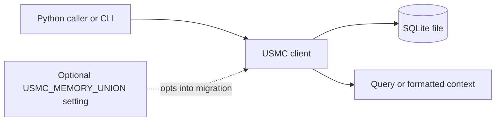

# USMC — United Shared Memory Client

> Corrected archival guide dated 2026-10-12. Direct predecessor: the former long `README.md`, now represented by the concise entry point [`../../README.md`](../../README.md) and this detailed guide at `docs/archive/README.full.en.md`. The source revision is [commit `bf281f1`](https://github.com/ellmos-ai/usmc/blob/bf281f1d68e9e6af44db9d12588a000fac531a61/README.md); this is a corrected archival edition, not an unchanged copy.

[English](../../README.md) | [Deutsch](../../README_de.md) | [Español](../../README_es.md)

This guide describes package source and declared metadata at the cited revision. Check the current entry point, source, and workflows for later changes.

## Contents

1. [Project scope and package facts](#sec-01)
2. [Stored records](#sec-02)
3. [Typical use](#sec-03)
4. [Design choices](#sec-04)
5. [Data flow](#sec-05)
6. [Storage view](#sec-06)
7. [Using one database from multiple processes](#sec-07)
8. [Boundaries and responsibilities](#sec-08)
9. [Quick start](#sec-09)
10. [Record types](#sec-10)
11. [Filtering and queries](#sec-11)
12. [Sessions and handoffs](#sec-12)
13. [Language and CLI](#sec-13)
14. [Database path and shared schema](#sec-14)
15. [Related project](#sec-15)
16. [Development checks](#sec-16)
17. [License inventory](#sec-17)
18. [Security, privacy, and legal scope](#sec-18)

<a id="sec-01"></a>
<a id="key-features"></a>
<a id="hauptmerkmale"></a>
<a id="características-principales"></a>
## 1. Project scope and package facts

USMC is a Python package and command-line client for writing and querying structured agent notes in SQLite. Its declared direct runtime dependency list is empty (`dependencies=[]`); it targets Python 3.10 or newer. The Git checkout, build backend, and test tools have their own network and license scopes.

The project is not affiliated with the United States Marine Corps.

<a id="sec-02"></a>
<a id="core-capabilities--primitives"></a>
<a id="kernkonzepte--primitive"></a>
<a id="conceptos-clave-y-primitivas"></a>
## 2. Stored records

| Record | Purpose |
|---|---|
| Facts | Category/key/value records with a confidence value and agent identifier. |
| Lessons | Problem, solution, severity, and source metadata. |
| Working notes | Short records with type, priority, optional tags, and session context. |
| Sessions | Start/end records and handoff notes. |

These are data features of the client; they do not enforce a policy on callers.

<a id="sec-03"></a>
<a id="target-personas--discoverability"></a>
<a id="zielgruppen--auffindbarkeit"></a>
<a id="arquetipos-de-usuario--visibilidad"></a>
## 3. Typical use

A caller can open a client, write a record, query it, and format context for its own prompt:

```python
from usmc import USMCClient

client = USMCClient(agent_id="codex")
client.add_fact("project", "status", "in progress", confidence=0.8)
client.add_working("Review the migration path", tags="sqlite,review")
print(client.generate_context())
```

Use `usmc --help` to see the installed CLI commands. The console entry point is declared in `pyproject.toml`.

<a id="sec-04"></a>
<a id="comparative-matrix-vs-alternatives"></a>
<a id="vergleichsmatrix-gegenueber-alternativen"></a>
<a id="matriz-comparativa-frente-a-alternativas"></a>
## 4. Design choices

USMC keeps its state in a SQLite database and uses SQLite transactions and WAL mode. This avoids requiring a separate database server for the default use. Callers may choose a custom database path and remain responsible for coordinating access, backup, and retention. Performance varies with hardware, SQLite version, database size, and workload; old benchmark figures are not a current guarantee.

<a id="sec-05"></a>
<a id="architecture--data-flow"></a>
<a id="architektur--datenfluss"></a>
<a id="arquitectura-y-flujo-de-datos"></a>
## 5. Data flow

A simplified data path is:



The drawing describes package calls and local persistence. It does not describe a host firewall, an OS permission change, or a remote service.

<a id="sec-06"></a>
<a id="ascii-topology"></a>
<a id="ascii-topologie"></a>
<a id="topologia-ascii"></a>
## 6. Storage view

```text
Caller / installed CLI
        |
        v
USMC Python package ---- reads/writes ----> chosen SQLite database path
        |
        +---- returns records or formatted context to the caller

Python/Git package installation and other caller processes are outside this local data path.
```

<a id="sec-07"></a>
<a id="multi-agent-interaction-sequence"></a>
<a id="multi-agenten-interaktionssequenz"></a>
<a id="secuencia-de-interacción-multi-agente"></a>
## 7. Using one database from multiple processes

Separate processes can open the same SQLite file. SQLite provides its documented transaction and locking behavior; USMC agent identifiers label records and do not authenticate processes or impose a single-writer lock. Applications must decide which processes can access the file and coordinate their own workflow.

<a id="sec-08"></a>
<a id="governance--runtime-invariants"></a>
<a id="governance--laufzeit-invarianten"></a>
<a id="invariantes-de-gobernanza-y-ejecución"></a>
## 8. Boundaries and responsibilities

| Area | Source-grounded scope |
|---|---|
| Runtime dependencies | `pyproject.toml` declares no direct project runtime dependencies; Python's standard library includes `sqlite3`. |
| Database location | Default `~/.usmc/usmc_memory.db`; `USMC_DB` and `--db` can select another path. |
| Network | Reviewed package modules contain no direct HTTP client. Git/pip/build tooling and callers may access the network. |
| Process privileges | USMC does not drop or elevate privileges; it runs with the launcher's process privileges. |
| Retention | The package does not automatically prune stored records. |
| Security assurance | No firewall, sandbox, encryption, certification, or full dependency/license audit is claimed here. |

These statements describe the reviewed source and declared metadata, not every deployment or caller.

<a id="sec-09"></a>
<a id="quick-start"></a>
<a id="schnellstart"></a>
<a id="inicio-rápido"></a>
## 9. Quick start

From the source repository, with Git and a Python packaging environment available:

```console
python -m pip install "git+https://github.com/ellmos-ai/usmc.git"
usmc --help
```

For a checkout:

```console
python -m pip install -e ".[test]"
```

Installing from Git requires network access. The direct runtime dependency list is empty, but build tools may still be needed by pip.

```python
from usmc import USMCClient

client = USMCClient(agent_id="codex")
client.add_fact("project", "framework", "FastAPI", confidence=0.9)
client.add_lesson(
    title="Windows encoding",
    problem="Subprocess output used the wrong encoding",
    solution="Configure the subprocess encoding explicitly",
    severity="high",
)
client.add_working("Review package metadata", tags="docs,release")
print(client.generate_context())
```

The default database is `~/.usmc/usmc_memory.db`. `USMC_DB` or the global `--db` option selects a different location.

<a id="sec-10"></a>
<a id="core-concepts--primitives"></a>
<a id="kernkonzepte--primitive-details"></a>
<a id="conceptos-clave-detalles"></a>
## 10. Record types

The client exposes facts, lessons, working notes, and session records. Facts are keyed by category, key, and agent; lesson records carry problem/solution fields and severity; working notes support tags; sessions capture task and handoff information. See Python docstrings and CLI help for current fields.

<a id="sec-11"></a>
<a id="finding-things--advanced-filtering"></a>
<a id="gezieltes-suchen--filterung"></a>
<a id="búsqueda-precisa-y-filtros"></a>
## 11. Filtering and queries

The CLI supports category, agent, severity, tag, and substring filters for the corresponding record commands. Examples:

```console
usmc facts --category project
usmc working --tags docs,release --tags-all
usmc lessons --severity high --grep encoding
```

Filter options are command-specific; consult `usmc facts --help`, `usmc working --help`, and `usmc lessons --help` for current syntax.

<a id="sec-12"></a>
<a id="multi-agent-session-coordination"></a>
<a id="multi-agenten-sitzungskoordination"></a>
<a id="coordinación-de-sesiones-multi-agente"></a>
## 12. Sessions and handoffs

A `USMCClient` accepts an `agent_id` label. Separate processes may use different labels while connecting to the same database file, but labels are data fields rather than identity checks. SQLite provides file-level coordination; the application remains responsible for access control and workflow decisions.

<a id="sec-13"></a>
<a id="runtime-language-contract"></a>
<a id="laufzeit-sprachvertrag"></a>
<a id="contrato-de-idioma-en-ejecución"></a>
## 13. Language and CLI

The Python API exposes `RUNTIME_LANGUAGE = "de"`. CLI command names and machine-readable keys are English tokens; human-facing messages include German strings and are not a multilingual locale framework.

<a id="sec-14"></a>
<a id="database-schema--state-isolation"></a>
<a id="datenbankschema--status-isolation"></a>
<a id="esquema-de-base-de-datos-y-aislamiento"></a>
## 14. Database path and shared schema

The default path is computed from `Path.home()` as `~/.usmc/usmc_memory.db`. `USMC_DB`, `--db`, or an explicit Python `db_path` overrides it; the chosen path is not restricted to the home directory.

The optional `USMC_MEMORY_UNION=1` path enables the shared-schema migration. The code creates a backup before migration and validates the known schema contract. Read the migration implementation and tests before enabling it on an existing database; keep your own backup.

<a id="sec-15"></a>
<a id="sibling-ecosystem--positioning"></a>
<a id="geschwister-oekosystem--positionierung"></a>
<a id="ecosistema-hermano-y-posicionamiento"></a>
## 15. Related projects

The source relationship reviewed for this guide is the optional shared-memory schema with [BACH](https://github.com/ellmos-ai/bach), represented by `usmc/memory_union.contract.json`. It is opt-in and does not imply that either project installs or launches the other.
[ellmos-stack](https://github.com/ellmos-ai/ellmos-stack) composes USMC as its curated-memory component in a self-hosted research stack; its installer fetches USMC from a pinned Git commit. This describes that stack composition, not an installation or launch guarantee provided by USMC.
[GARDENER](https://github.com/ellmos-ai/gardener) offers optional read-only source templates for USMC replica snapshots; they are disabled by default and require a separate sync snapshot plus caller opt-in.

<a id="sec-16"></a>
<a id="testing--quality-gates"></a>
<a id="testen--qualitaetstore"></a>
<a id="pruebas-y-verificacion"></a>
## 16. Development checks

From a checkout, common checks are:

```console
python -m pytest -ra -v
python -m ruff check .
python -m compileall -q usmc tests
```

These commands require their development tools. CI workflow configuration is available in [`.github/workflows`](../../.github/workflows). Test status changes over time; consult the current workflow page rather than copying an old count.

<a id="sec-17"></a>
<a id="third-party-licenses--transparency"></a>
<a id="drittanbieter-lizenzen--transparenz"></a>
<a id="licencias-de-terceros-y-transparencia"></a>
## 17. License inventory

The project license is MIT. `THIRD_PARTY_LICENSES.md` and `.txt` list selected direct runtime, build, and test components with their declared scopes. They are not a complete audit of every transitive dependency or every downstream distribution.

<a id="sec-18"></a>
<a id="security-policy--liability"></a>
<a id="sicherheitsrichtlinie--haftung"></a>
<a id="politica-de-seguridad-y-responsabilidad"></a>
<a id="license--liability"></a>
<a id="lizenz--haftung"></a>
<a id="licencia-y-responsabilidad"></a>
<a id="security-policy--vulnerability-reporting"></a>
<a id="sicherheitsrichtlinie--meldewege"></a>
<a id="política-de-seguridad-y-reporte-de-vulnerabilidades"></a>
## 18. Security, privacy, and legal scope

USMC writes records to the configured SQLite path. The reviewed package source has no direct HTTP client, but Git/pip/build tools and calling processes may use the network. The library does not create a firewall or sandbox, does not change process privileges, and does not automatically prune records. The host filesystem and process permissions apply; choose the database path, backups, and retention policy for your use case.

Please use the private reporting route described in [`SECURITY.md`](../../SECURITY.md). The stated maintainer response times are targets, not a contractual service-level guarantee.

The project is provided under the MIT license. Whether statutory rules such as [section 516 BGB](https://www.gesetze-im-internet.de/bgb/__516.html) or [section 521 BGB](https://www.gesetze-im-internet.de/bgb/__521.html) apply depends on the legal relationship and applicable law; this documentation does not provide a blanket exemption from liability. See [`LICENSE`](../../LICENSE) and [`NOTICE`](../../NOTICE).