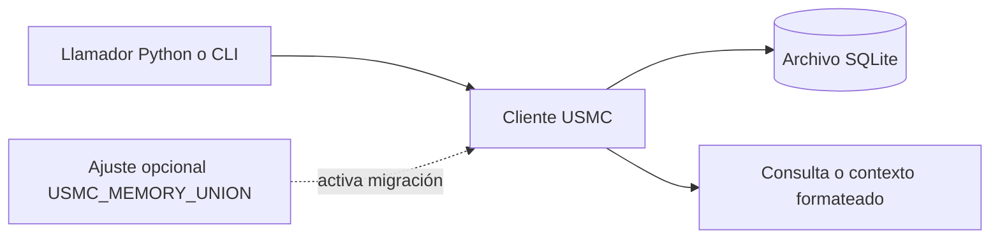

# USMC — United Shared Memory Client

> Guía archivada corregida, fechada el 12-10-2026. Predecesor directo: el antiguo `README_es.md` extenso, ahora representado por la página breve [`../../README_es.md`](../../README_es.md) y esta guía detallada en `docs/archive/README.full.es.md`. La revisión fuente es el [commit `bf281f1`](https://github.com/ellmos-ai/usmc/blob/bf281f1d68e9e6af44db9d12588a000fac531a61/README_es.md); esta edición está corregida y no es una copia intacta.

[English](../../README.md) | [Deutsch](../../README_de.md) | [Español](../../README_es.md)

Esta guía describe el código fuente del paquete y los metadatos declarados en la revisión citada. Consulta la página de entrada, el código y los flujos actuales para cambios posteriores.

## Contenido

1. [Alcance del proyecto y datos del paquete](#sec-01)
2. [Registros almacenados](#sec-02)
3. [Uso habitual](#sec-03)
4. [Decisiones de diseño](#sec-04)
5. [Flujo de datos](#sec-05)
6. [Vista del almacenamiento](#sec-06)
7. [Uso de una base de datos desde varios procesos](#sec-07)
8. [Límites y responsabilidades](#sec-08)
9. [Inicio rápido](#sec-09)
10. [Tipos de registro](#sec-10)
11. [Filtros y consultas](#sec-11)
12. [Sesiones y traspasos](#sec-12)
13. [Idioma y CLI](#sec-13)
14. [Ruta de la base de datos y esquema compartido](#sec-14)
15. [Proyecto relacionado](#sec-15)
16. [Comprobaciones de desarrollo](#sec-16)
17. [Inventario de licencias](#sec-17)
18. [Seguridad, privacidad y alcance legal](#sec-18)

<a id="sec-01"></a>
<a id="características-principales"></a>
<a id="key-features"></a>
<a id="hauptmerkmale"></a>
## 1. Alcance del proyecto y datos del paquete

USMC es un paquete de Python y un cliente de línea de comandos para guardar y consultar notas estructuradas de agentes en SQLite. La lista declarada de dependencias directas en ejecución está vacía (`dependencies=[]`); requiere Python 3.10 o posterior. La copia Git, el backend de compilación y las herramientas de prueba tienen sus propios alcances de red y licencia.

El proyecto no está afiliado al Cuerpo de Marines de los Estados Unidos.

<a id="sec-02"></a>
<a id="capacidades-clave--primitivas"></a>
<a id="core-capabilities--primitives"></a>
<a id="kernkonzepte--primitive"></a>
## 2. Registros almacenados

| Registro | Propósito |
|---|---|
| Hechos | Registros de categoría/clave/valor con nivel de confianza e identificador del agente. |
| Lecciones | Problema, solución, gravedad y metadatos de origen. |
| Notas de trabajo | Registros breves con tipo, prioridad, etiquetas opcionales y contexto de sesión. |
| Sesiones | Registros de inicio/fin y notas de traspaso. |

Estas funciones de datos no hacen cumplir políticas en los procesos que llaman al paquete.

<a id="sec-03"></a>
<a id="arquetipos-de-usuario--visibilidad"></a>
<a id="target-personas--discoverability"></a>
<a id="zielgruppen--auffindbarkeit"></a>
## 3. Uso habitual

Un llamador puede abrir un cliente, guardar un registro, consultarlo y generar contexto para su propio prompt:

```python
from usmc import USMCClient

client = USMCClient(agent_id="codex")
client.add_fact("project", "status", "en curso", confidence=0.8)
client.add_working("Revisar la migración", tags="sqlite,review")
print(client.generate_context())
```

`usmc --help` muestra los comandos de la CLI instalada. El punto de entrada de consola está declarado en `pyproject.toml`.

<a id="sec-04"></a>
<a id="matriz-comparativa-frente-a-alternativas"></a>
<a id="comparative-matrix-vs-alternatives"></a>
<a id="vergleichsmatrix-gegenueber-alternativen"></a>
## 4. Decisiones de diseño

USMC guarda el estado en una base de datos SQLite y usa transacciones y el modo WAL de SQLite. El uso predeterminado no requiere un servidor de base de datos aparte. Los llamadores pueden elegir una ruta personalizada y son responsables de coordinar el acceso, las copias y la retención. El rendimiento depende del hardware, la versión de SQLite, el tamaño de la base y la carga; las cifras de pruebas antiguas no son una garantía actual.

<a id="sec-05"></a>
<a id="arquitectura-y-flujo-de-datos"></a>
<a id="architecture--data-flow"></a>
<a id="architektur--datenfluss"></a>
## 5. Flujo de datos

Flujo de datos simplificado:



El diagrama describe llamadas al paquete y almacenamiento local. No describe un firewall del sistema, cambios de privilegios ni un servicio de red.

<a id="sec-06"></a>
<a id="topologia-ascii"></a>
<a id="ascii-topology"></a>
<a id="ascii-topologie"></a>
## 6. Vista del almacenamiento

```text
Llamador / CLI instalada
        |
        v
Paquete Python USMC ---- lee/escribe ----> ruta elegida de base SQLite
        |
        +---- devuelve registros o contexto formateado al llamador

La instalación mediante Python/Git y otros procesos llamadores quedan fuera de este flujo local.
```

<a id="sec-07"></a>
<a id="secuencia-de-interacción-multi-agente"></a>
<a id="multi-agent-interaction-sequence"></a>
<a id="multi-agenten-interaktionssequenz"></a>
## 7. Uso de una base de datos desde varios procesos

Varios procesos pueden abrir el mismo archivo SQLite. SQLite proporciona su comportamiento documentado de transacciones y bloqueos; los identificadores de agente etiquetan registros, pero no autentican procesos ni imponen un bloqueo de escritor único. Cada aplicación decide qué procesos pueden acceder al archivo y cómo coordina su flujo de trabajo.

<a id="sec-08"></a>
<a id="invariantes-de-gobernanza-y-ejecución"></a>
<a id="governance--runtime-invariants"></a>
<a id="governance--laufzeit-invarianten"></a>
## 8. Límites y responsabilidades

| Área | Alcance respaldado por el código fuente |
|---|---|
| Dependencias de ejecución | `pyproject.toml` no declara dependencias directas del proyecto; la biblioteca estándar de Python incluye `sqlite3`. |
| Ruta de la base | Predeterminada `~/.usmc/usmc_memory.db`; `USMC_DB` y `--db` pueden elegir otra. |
| Red | Los módulos del paquete revisados no contienen un cliente HTTP directo. Git/pip/compilación y los llamadores pueden usar la red. |
| Privilegios del proceso | USMC no reduce ni eleva privilegios; hereda los del proceso que lo inicia. |
| Retención | El paquete no purga registros automáticamente. |
| Garantías de seguridad | Aquí no se afirma que haya firewall, sandbox, cifrado, certificación ni auditoría completa de dependencias/licencias. |

Estas notas describen el código revisado y los metadatos declarados, no cada despliegue o llamador.

<a id="sec-09"></a>
<a id="inicio-rápido"></a>
<a id="quick-start"></a>
<a id="schnellstart"></a>
## 9. Inicio rápido

Desde el repositorio fuente, con Git y un entorno de empaquetado de Python:

```console
python -m pip install "git+https://github.com/ellmos-ai/usmc.git"
usmc --help
```

Para una copia local:

```console
python -m pip install -e ".[test]"
```

La instalación desde Git requiere acceso a la red. La lista directa de dependencias en ejecución está vacía, pero pip puede necesitar herramientas de compilación.

```python
from usmc import USMCClient

client = USMCClient(agent_id="codex")
client.add_fact("project", "framework", "FastAPI", confidence=0.9)
client.add_lesson(
    title="Codificación en Windows",
    problem="La salida del subproceso usó una codificación incorrecta",
    solution="Configurar explícitamente la codificación del subproceso",
    severity="high",
)
client.add_working("Revisar metadatos del paquete", tags="docs,release")
print(client.generate_context())
```

La ruta predeterminada es `~/.usmc/usmc_memory.db`. `USMC_DB`, la opción global `--db` o el argumento Python `db_path` permiten elegir otra.

<a id="sec-10"></a>
<a id="conceptos-clave-y-primitivas"></a>
<a id="core-concepts--primitives"></a>
<a id="kernkonzepte--detaillierte-primitive"></a>
## 10. Tipos de registro

El cliente ofrece registros de hechos, lecciones, notas de trabajo y sesiones. Los hechos usan categoría, clave, valor e identificador del agente; las lecciones guardan problema/solución y gravedad; las notas de trabajo admiten etiquetas; las sesiones registran tareas y traspasos. Consulta los docstrings de Python y la ayuda de la CLI para conocer los campos actuales.

<a id="sec-11"></a>
<a id="búsqueda-precisa-y-filtros"></a>
<a id="finding-things--advanced-filtering"></a>
<a id="gezieltes-suchen--filterung"></a>
## 11. Filtros y consultas

Según el comando, la CLI permite filtrar por categoría, agente, gravedad, etiqueta y subcadena:

```console
usmc facts --category project
usmc working --tags docs,release --tags-all
usmc lessons --severity high --grep encoding
```

Las opciones dependen de cada comando. Consulta `usmc facts --help`, `usmc working --help` y `usmc lessons --help` para ver la sintaxis actual.

<a id="sec-12"></a>
<a id="coordinación-de-sesiones-multi-agente"></a>
<a id="multi-agent-session-coordination"></a>
<a id="multi-agenten-sitzungskoordination"></a>
## 12. Sesiones y traspasos

`USMCClient` acepta una etiqueta `agent_id`. Varios procesos pueden usar etiquetas distintas y abrir el mismo archivo, pero la etiqueta es un campo de datos, no una comprobación de identidad. SQLite coordina el acceso al archivo; el control de acceso y las decisiones del flujo pertenecen a la aplicación.

<a id="sec-13"></a>
<a id="contrato-de-idioma-en-ejecución"></a>
<a id="runtime-language-contract"></a>
<a id="laufzeit-sprachvertrag"></a>
## 13. Idioma y CLI

La API Python expone `RUNTIME_LANGUAGE = "de"`. Los nombres de comandos y las claves legibles por máquina son tokens en inglés; los mensajes para personas contienen textos en alemán. El paquete no ofrece un marco de localización multilingüe.

<a id="sec-14"></a>
<a id="esquema-de-base-de-datos-y-aislamiento"></a>
<a id="database-schema--state-isolation"></a>
<a id="datenbankschema--status-isolation"></a>
## 14. Ruta de la base de datos y esquema compartido

La ruta predeterminada se calcula con `Path.home()` como `~/.usmc/usmc_memory.db`. `USMC_DB`, `--db` o `db_path` en Python la sustituyen; la ruta elegida no está limitada al directorio del usuario.

`USMC_MEMORY_UNION=1` activa la ruta opcional de migración de esquema compartido. El código crea una copia de seguridad antes de migrar y valida el contrato conocido. Lee la implementación y las pruebas antes de activarlo en una base existente y conserva tu propia copia.

<a id="sec-15"></a>
<a id="ecosistema-hermano-y-posicionamiento"></a>
<a id="sibling-ecosystem--positioning"></a>
<a id="geschwister-oekosystem--positionierung"></a>
## 15. Proyectos relacionados

La relación fuente revisada para esta guía es el esquema de memoria compartida opcional con [BACH](https://github.com/ellmos-ai/bach), descrito por `usmc/memory_union.contract.json`. Es optativo y no significa que un proyecto instale o inicie el otro.
[ellmos-stack](https://github.com/ellmos-ai/ellmos-stack) incluye USMC como componente de memoria curada en una pila de investigación autohospedada; su instalador obtiene USMC de un commit Git fijado. Esta relación describe la composición del stack; USMC no instala ni inicia ellmos-stack.
[GARDENER](https://github.com/ellmos-ai/gardener) ofrece plantillas opcionales de solo lectura para instantáneas réplica de USMC; están desactivadas por defecto y requieren una instantánea creada por un mecanismo de sincronización separado y la activación del llamador.

<a id="sec-16"></a>
<a id="pruebas-y-verificacion"></a>
<a id="testing--quality-gates"></a>
<a id="testen--qualitaetstore"></a>
## 16. Comprobaciones de desarrollo

En una copia del código fuente, las comprobaciones habituales son:

```console
python -m pytest -ra -v
python -m ruff check .
python -m compileall -q usmc tests
```

Se necesitan las herramientas de desarrollo. La configuración de CI está en [`.github/workflows`](../../.github/workflows). Los resultados cambian; consulta la página actual del flujo de trabajo.

<a id="sec-17"></a>
<a id="licencias-de-terceros-y-transparencia"></a>
<a id="third-party-licenses--transparency"></a>
<a id="drittanbieter-lizenzen--transparenz"></a>
## 17. Inventario de licencias

La licencia del proyecto es MIT. `THIRD_PARTY_LICENSES.md` y `.txt` enumeran componentes seleccionados de ejecución, compilación y pruebas junto con su alcance declarado. No son una auditoría completa de cada dependencia transitiva ni de cada distribución posterior.

<a id="sec-18"></a>
<a id="politica-de-seguridad-y-responsabilidad"></a>
<a id="security-policy--liability"></a>
<a id="sicherheitsrichtlinie--haftung"></a>
<a id="licencia-y-responsabilidad"></a>
<a id="license--liability"></a>
<a id="lizenz--haftung"></a>
<a id="política-de-seguridad-y-reporte-de-vulnerabilidades"></a>
<a id="security-policy--vulnerability-reporting"></a>
<a id="sicherheitsrichtlinie--meldewege"></a>
## 18. Seguridad, privacidad y alcance legal

USMC escribe registros en la ruta SQLite configurada. El código fuente del paquete revisado no contiene un cliente HTTP directo, pero las herramientas Git/pip/compilación y los procesos llamadores pueden usar la red. La biblioteca no crea firewall ni sandbox, no cambia privilegios del proceso y no elimina registros automáticamente. Se aplican los permisos del sistema de archivos y del proceso anfitrión. Elige la ruta, las copias y la retención según el uso previsto.

Usa el canal privado de [`SECURITY.md`](../../SECURITY.md) para informar problemas de seguridad. Los plazos de respuesta indicados son objetivos, no un nivel de servicio contractual.

El proyecto se ofrece bajo la licencia MIT. La aplicación de normas legales como el artículo 516 BGB o el artículo 521 BGB depende de la relación jurídica y de la ley aplicable; esta documentación no ofrece una exención general de responsabilidad. Véanse los textos oficiales: https://www.gesetze-im-internet.de/bgb/__516.html y https://www.gesetze-im-internet.de/bgb/__521.html. Consulta [`LICENSE`](../../LICENSE) y [`NOTICE`](../../NOTICE).